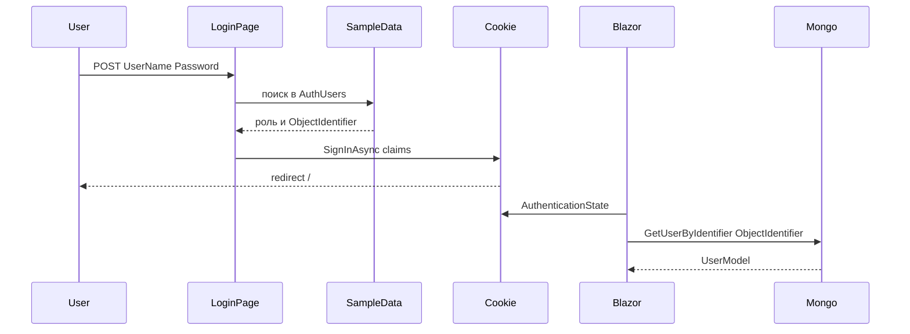

# Архитектура

## Проекты

| Проект | Путь | Ответственность |
|--------|------|-----------------|
| **QuestionAppUI** | [`QuestionAppUI/`](../QuestionAppUI/) | Blazor Server host: страницы, компоненты, cookie-auth, seed UI, регистрация DI |
| **QuestionAppLibrary** | [`QuestionAppLibrary/`](../QuestionAppLibrary/) | Доменные модели и доступ к MongoDB (`I*Data` / `Mongo*`) |

Точка входа: [`Program.cs`](../QuestionAppUI/Program.cs) → `builder.ConfigureServices()` из [`RegisterServices.cs`](../QuestionAppUI/RegisterServices.cs).

Pipeline:

1. `UseHttpsRedirection` / `UseStaticFiles` / `UseRouting`
2. `UseAuthentication` / `UseAuthorization`
3. `MapBlazorHub` / `MapFallbackToPage("/_Host")`

## Dependency Injection

Регистрация в [`RegisterServices.ConfigureServices`](../QuestionAppUI/RegisterServices.cs):

| Сервис | Lifetime | Реализация |
|--------|----------|------------|
| `IDbConnection` | Singleton | `DbConnection` |
| `ICategoryData` | Singleton | `MongoCategoryData` |
| `IStatusData` | Singleton | `MongoStatusData` |
| `IUserData` | Singleton | `MongoUserData` |
| `IQuestionData` | Singleton | `MongoQuestionData` |
| `IAnswerData` | Singleton | `MongoAnswerData` |
| `ToasterService` | Singleton | `ToasterService` |

Также: `AddRazorPages`, `AddServerSideBlazor`, `AddMemoryCache`, cookie authentication (срок cookie — 20 дней), `AddAuthorization`.

## Аутентификация и авторизация



- Схема: Cookie Authentication.
- Логин: [`/identity/account/login`](../QuestionAppUI/Areas/Identity/Pages/Account/Login.cshtml) — сверка с жёстко заданным списком [`SampleData.AuthUsers`](../QuestionAppUI/Data/SampleData.cs) (не Mongo, пароли в открытом виде).
- Claims: `ClaimTypes.Name`, `ClaimTypes.Role`, `ObjectIdentifier`.
- Связь с профилем в БД: [`AuthenticationStateProviderHelper.GetUserFromAuth`](../QuestionAppUI/Helpers/AuthenticationStateProviderHelper.cs) читает `ObjectIdentifier` и загружает `UserModel` через `IUserData`.
- Logout: [`/identiy/account/logout`](../QuestionAppUI/Areas/Identity/Pages/Account/Logout.cshtml) (в пути опечатка `identiy`).
- UI: `CascadingAuthenticationState` + `AuthorizeRouteView` в [`App.razor`](../QuestionAppUI/App.razor); неавторизованным показывается [`NotAutorized.razor`](../QuestionAppUI/Shared/NotAutorized.razor).
- Роли: `User`, `Admin` (`[Authorize]`, `[Authorize(Roles = "Admin")]`, `AuthorizeView`).

Демо-пользователи: `Ramil` / `Tom` / `Kate` (User), `Admin` (Admin); пароль у всех `1234`.

## Слой данных (MongoDB)

База: `QuestionApp` (ключ конфигурации `DatabaseName`).  
Подключение: [`DbConnection`](../QuestionAppLibrary/DataAccess/DbConnection.cs) читает `ConnectionStrings:MongoDB`.

### Коллекции

| Свойство в коде | Коллекция |
|-----------------|-----------|
| `CategoryCollection` | `categories` |
| `StatusCollection` | `statuses` |
| `UserCollection` | `users` |
| `QuestionCollection` | `questions` |
| `AnswerCollection` | `answers` |

### Модели

| Модель | Назначение |
|--------|------------|
| `UserModel` | Профиль пользователя, списки своих/проголосованных вопросов и ответов |
| `QuestionModel` | Вопрос, категории, статус, автор, голоса, флаги approve/reject/archive |
| `AnswerModel` | Ответ, автор, голоса, `IsApproved`, связь с вопросом |
| `CategoryModel` / `StatusModel` | Справочники |
| `BasicUserModel` / `BasicQuestionModel` / `BasicAnswerModel` | Вложенные сокращённые представления |

### Кэширование (`IMemoryCache`)

| Данные | Ключ кэша | TTL |
|--------|-----------|-----|
| Категории | `CategoryData` | 1 день |
| Статусы | `StatusData` | 1 день |
| Вопросы | `QuestionData` | 1 минута (сбрасывается при Update / UpVote) |

Пользователи и ответы не кэшируются. Многие выборки вопросов фильтруют полный список из кэша в памяти (LINQ).

## Маршруты

| Маршрут | Файл | Доступ | Назначение |
|---------|------|--------|------------|
| `/` | [`Index.razor`](../QuestionAppUI/Pages/Index.razor) | Публичный | Список одобренных вопросов, фильтры, голосование |
| `/Create` | [`Create.razor`](../QuestionAppUI/Pages/Create.razor) | `[Authorize]` | Создание вопроса |
| `/Edit/{Id}` | [`Edit.razor`](../QuestionAppUI/Pages/Edit.razor) | `[Authorize]` | Редактирование (автор или Admin) |
| `/Details/{Id}` | [`Details.razor`](../QuestionAppUI/Pages/Details.razor) | Публичный | Детали, ответы, смена статуса (Admin) |
| `/AdminApproval` | [`AdminApproval.razor`](../QuestionAppUI/Pages/AdminApproval.razor) | Admin | Модерация очереди |
| `/Profile` | [`Profile.razor`](../QuestionAppUI/Pages/Profile.razor) | Без атрибута на странице | Вопросы текущего пользователя по статусам |
| `/SampleData` | [`SampleData.razor`](../QuestionAppUI/Pages/SampleData.razor) | Открытый | Засев демо-данных |
| `/identity/account/login` | Login Razor Page | Гость | Вход |
| `/identiy/account/logout` | Logout Razor Page | — | Выход |
| `/_Host` | [`_Host.cshtml`](../QuestionAppUI/Pages/_Host.cshtml) | — | Хост Blazor-приложения |

## Основной пользовательский поток

```mermaid
flowchart LR
  Create[/Create] --> Pending[Question_pending]
  Pending --> Admin[/AdminApproval]
  Admin -->|approve| Index[/Index_approved]
  Index --> Details[/Details]
  Details --> Answers[Answers_and_status]
  Index --> Profile[/Profile]
```

1. Авторизованный пользователь создаёт вопрос (`IsAproved = false`).
2. Admin одобряет или отклоняет на `/AdminApproval`.
3. Одобренные вопросы видны на `/`.
4. На `/Details/{Id}` можно голосовать, отвечать; Admin задаёт статус вопроса.
5. `/Profile` группирует вопросы автора (approved / archived / rejected / pending).

## UI-компоненты

| Компонент | Путь | Роль |
|-----------|------|------|
| `QuestionEditor` | [`Components/QuestionEditor/`](../QuestionAppUI/Components/QuestionEditor/) | Общая форма создания/редактирования (Radzen HTML editor) |
| `Toaster` / `ToasterService` | [`Components/Toaster/`](../QuestionAppUI/Components/Toaster/) | Уведомления (например, после сохранения ответа) |
| `LoginDisplay` | [`Shared/LoginDisplay.razor`](../QuestionAppUI/Shared/LoginDisplay.razor) | Ссылки Login / Logout / Profile / Admin |
| `MainLayout` | [`Shared/MainLayout.razor`](../QuestionAppUI/Shared/MainLayout.razor) | Общий layout |

Хелперы:

- [`Urls.cs`](../QuestionAppUI/Helpers/Urls.cs) — пути login/logout
- [`AuthenticationStateProviderHelper.cs`](../QuestionAppUI/Helpers/AuthenticationStateProviderHelper.cs) — claim → Mongo user

## Известные ограничения (демо)

Документируются как есть, без предложений по исправлению:

1. Пароли демо-пользователей хранятся и сравниваются в открытом виде в коде.
2. `/SampleData` доступен без авторизации.
3. В `Program.cs` нет вызова `MapRazorPages()` при зарегистрированных Razor Pages (login/logout).
4. В пути logout опечатка: `/identiy/...`.
5. Mongo-транзакции при создании вопроса / upvote закомментированы.
6. Новые ответы создаются с `IsApproved = false`; отдельного UI одобрения ответов нет.
7. HTML вопросов/ответов выводится как `MarkupString` (риск XSS при недоверенном контенте).
8. У Radzen-редактора указан `UploadUrl="upload/image"` без реализованного endpoint загрузки.
9. Часть UI-сценариев не доведена (архивация на Index, правка профиля, подпись ссылки Admin).
10. Базовый `appsettings.json` содержит пустую строку подключения; для Development значение задано отдельно.
