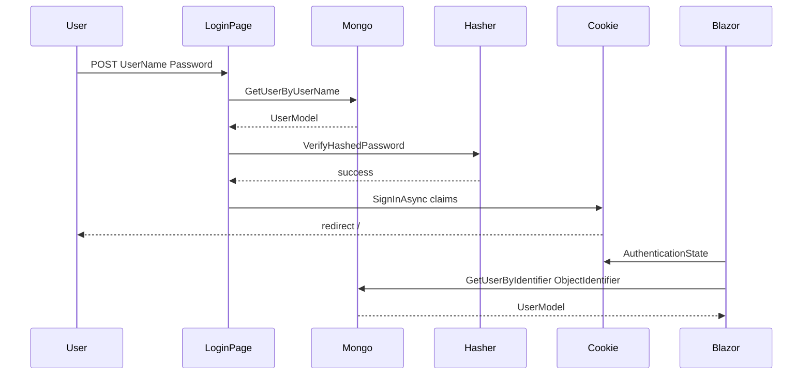

# Архитектура

## Проекты

| Проект | Путь | Ответственность |
|--------|------|-----------------|
| **QuestionAppUI** | [`QuestionAppUI/`](../QuestionAppUI/) | Blazor Server host: страницы, компоненты, cookie-auth, seed UI, регистрация DI |
| **QuestionAppLibrary** | [`QuestionAppLibrary/`](../QuestionAppLibrary/) | Доменные модели и доступ к MongoDB (`I*Data` / `Mongo*`) |

Точка входа: [`Program.cs`](../QuestionAppUI/Program.cs) → `builder.ConfigureServices()` из [`RegisterServices.cs`](../QuestionAppUI/RegisterServices.cs).

Pipeline:

1. `UseHttpsRedirection` / `UseStaticFiles` / `UseRouting`
2. `UseAuthentication` / `UseAuthorization`
3. `MapBlazorHub` / `MapFallbackToPage("/_Host")`

## Dependency Injection

Регистрация в [`RegisterServices.ConfigureServices`](../QuestionAppUI/RegisterServices.cs):

| Сервис | Lifetime | Реализация |
|--------|----------|------------|
| `IDbConnection` | Singleton | `DbConnection` |
| `ICategoryData` | Singleton | `MongoCategoryData` |
| `IStatusData` | Singleton | `MongoStatusData` |
| `IUserData` | Singleton | `MongoUserData` |
| `IQuestionData` | Singleton | `MongoQuestionData` |
| `IAnswerData` | Singleton | `MongoAnswerData` |
| `ToasterService` | Singleton | `ToasterService` |

Также: `AddRazorPages`, `AddServerSideBlazor`, `AddMemoryCache`, cookie authentication (срок cookie — 20 дней), `AddAuthorization`, `IPasswordHasher<UserModel>`.

При старте [`Program.cs`](../QuestionAppUI/Program.cs) вызывает [`DemoUserSeeder`](../QuestionAppUI/Helpers/DemoUserSeeder.cs) — создаёт/дополняет демо-пользователей в Mongo с хешем пароля.

## Аутентификация и авторизация



- Схема: Cookie Authentication.
- Источник пользователей: Mongo `UserModel` (`UserName`, `PasswordHash`, `Role`, `ObjectIdentifier`).
- Логин: [`Login.cshtml.cs`](../QuestionAppUI/Areas/Identity/Pages/Account/Login.cshtml.cs) — `PasswordHasher<UserModel>`.
- Claims: `ClaimTypes.Name`, `ClaimTypes.Role`, `ObjectIdentifier`.
- Профиль в UI: [`AuthenticationStateProviderHelper`](../QuestionAppUI/Helpers/AuthenticationStateProviderHelper.cs).
- Logout: [`/identity/account/logout`](../QuestionAppUI/Areas/Identity/Pages/Account/Logout.cshtml).
- Upload изображений: `POST /upload/image` (только для авторизованных) → `wwwroot/uploads/`.

Демо-пользователи: `Ramil` / `Tom` / `Kate` (User), `Admin` (Admin); пароль у всех `1234` (в БД только hash).

## Слой данных (MongoDB)

База: `QuestionApp` (ключ конфигурации `DatabaseName`).  
Подключение: [`DbConnection`](../QuestionAppLibrary/DataAccess/DbConnection.cs) читает `ConnectionStrings:MongoDB`.

### Коллекции

| Свойство в коде | Коллекция |
|-----------------|-----------|
| `CategoryCollection` | `categories` |
| `StatusCollection` | `statuses` |
| `UserCollection` | `users` |
| `QuestionCollection` | `questions` |
| `AnswerCollection` | `answers` |

### Модели

| Модель | Назначение |
|--------|------------|
| `UserModel` | Профиль пользователя, списки своих/проголосованных вопросов и ответов |
| `QuestionModel` | Вопрос, категории, статус, автор, голоса, флаги approve/reject/archive |
| `AnswerModel` | Ответ, автор, голоса, `IsApproved`, связь с вопросом |
| `CategoryModel` / `StatusModel` | Справочники |
| `BasicUserModel` / `BasicQuestionModel` / `BasicAnswerModel` | Вложенные сокращённые представления |

### Кэширование (`IMemoryCache`)

| Данные | Ключ кэша | TTL |
|--------|-----------|-----|
| Категории | `CategoryData` | 1 день |
| Статусы | `StatusData` | 1 день |
| Вопросы | `QuestionData` | 1 минута (сбрасывается при Update / UpVote) |

Пользователи и ответы не кэшируются. Многие выборки вопросов фильтруют полный список из кэша в памяти (LINQ).

## Маршруты

| Маршрут | Файл | Доступ | Назначение |
|---------|------|--------|------------|
| `/` | [`Index.razor`](../QuestionAppUI/Pages/Index.razor) | Публичный | Список одобренных вопросов, фильтры, голосование |
| `/Create` | [`Create.razor`](../QuestionAppUI/Pages/Create.razor) | `[Authorize]` | Создание вопроса |
| `/Edit/{Id}` | [`Edit.razor`](../QuestionAppUI/Pages/Edit.razor) | `[Authorize]` | Редактирование (автор или Admin) |
| `/Details/{Id}` | [`Details.razor`](../QuestionAppUI/Pages/Details.razor) | Публичный | Детали, ответы, смена статуса (Admin) |
| `/AdminApproval` | [`AdminApproval.razor`](../QuestionAppUI/Pages/AdminApproval.razor) | Admin | Модерация очереди |
| `/AdminPanel` | [`AdminPanel.razor`](../QuestionAppUI/Pages/AdminPanel.razor) | Admin | Создание одобренных вопросов и ответов |
| `/Profile` | [`Profile.razor`](../QuestionAppUI/Pages/Profile.razor) | `[Authorize]` | Вопросы текущего пользователя по статусам |
| `/SampleData` | [`SampleData.razor`](../QuestionAppUI/Pages/SampleData.razor) | Admin | Засев демо-данных |
| `/upload/image` | Minimal API в `Program.cs` | `[Authorize]` | Загрузка изображений для Radzen |
| `/identity/account/login` | Login Razor Page | Гость | Вход |
| `/identity/account/logout` | Logout Razor Page | — | Выход |
| `/_Host` | [`_Host.cshtml`](../QuestionAppUI/Pages/_Host.cshtml) | — | Хост Blazor-приложения |

## Основной пользовательский поток

```mermaid
flowchart LR
  Create[/Create] --> Pending[Question_pending]
  Pending --> Admin[/AdminApproval]
  Admin -->|approve| Index[/Index_approved]
  Index --> Details[/Details]
  Details --> Answers[Answers_and_status]
  Index --> Profile[/Profile]
```

1. Авторизованный пользователь создаёт вопрос (`IsApproved = false`).
2. Admin одобряет или отклоняет на `/AdminApproval` (или публикует сразу через `/AdminPanel`).
3. Одобренные вопросы видны на `/`.
4. На `/Details/{Id}` можно голосовать, отвечать; Admin задаёт статус вопроса.
5. `/Profile` группирует вопросы автора (approved / archived / rejected / pending).

## UI-компоненты

| Компонент | Путь | Роль |
|-----------|------|------|
| `QuestionEditor` | [`Components/QuestionEditor/`](../QuestionAppUI/Components/QuestionEditor/) | Общая форма создания/редактирования (Radzen HTML editor) |
| `Toaster` / `ToasterService` | [`Components/Toaster/`](../QuestionAppUI/Components/Toaster/) | Уведомления (например, после сохранения ответа) |
| `LoginDisplay` | [`Shared/LoginDisplay.razor`](../QuestionAppUI/Shared/LoginDisplay.razor) | Ссылки Login / Logout / Profile / Admin |
| `MainLayout` | [`Shared/MainLayout.razor`](../QuestionAppUI/Shared/MainLayout.razor) | Общий layout |
| `NotAuthorized` | [`Shared/NotAuthorized.razor`](../QuestionAppUI/Shared/NotAuthorized.razor) | Экран отказа в доступе |

Хелперы:

- [`Urls.cs`](../QuestionAppUI/Helpers/Urls.cs) — пути login/logout
- [`AuthenticationStateProviderHelper.cs`](../QuestionAppUI/Helpers/AuthenticationStateProviderHelper.cs) — claim → Mongo user
- [`DemoUserSeeder.cs`](../QuestionAppUI/Helpers/DemoUserSeeder.cs) — seed демо-пользователей с хешем пароля
- [`SafeHtml.cs`](../QuestionAppUI/Helpers/SafeHtml.cs) — санитизация HTML

## Известные ограничения

1. Нет полноценного ASP.NET Core Identity (регистрация, reset password, lockout) — cookie + Mongo users + `PasswordHasher`.
2. BSON-поля старых опечаток сохранены через `[BsonElement]` (`IsAproved`, `AutoredQuestions`) для совместимости с уже записанными документами.
3. Нет автотестов, Docker и CI.
