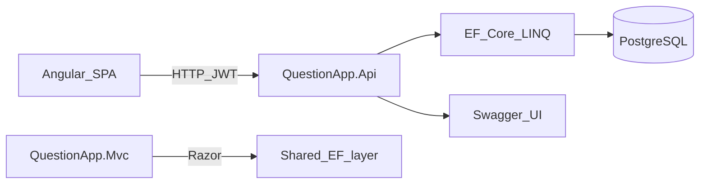
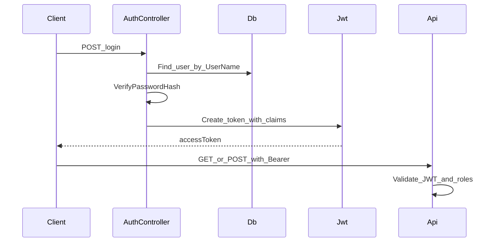

# План перехода на стек вакансий

Учебный маршрут: переписать QuestionApp **с нуля маленькими шагами** на стек, который чаще всего встречается в вакансиях .NET + frontend.

Текущий проект (Blazor Server + MongoDB) **не удаляем** — он остаётся справочником по домену и UX. Новый код живёт в папке [`rewrite/`](../rewrite/).

Связанные документы:

- [TECHNOLOGY_MAP.md](TECHNOLOGY_MAP.md) — текущий стек (as-is)
- [ARCHITECTURE.md](ARCHITECTURE.md) — текущая архитектура (as-is)
- [TECHNICAL_SPECIFICATION.md](TECHNICAL_SPECIFICATION.md) — продуктовый бэклог (FR); использовать как идеи фич, не как ограничение стека
- [ANGULAR_LEARNING_PLAN.md](ANGULAR_LEARNING_PLAN.md) — обучение Angular/TS по дням и детализация UI-этапов 6–8

---

## Зачем этот план

Вакансия ожидает не «умею Blazor + Mongo», а связку:

| Ожидание вакансии | Что тренируем |
|-------------------|---------------|
| C# | весь backend |
| PostgreSQL | реляционная БД |
| Entity Framework, LINQ | ORM + запросы |
| .NET Web API, Swagger | HTTP API и контракт |
| ASP.NET MVC | отдельный короткий этап |
| TypeScript, JavaScript, HTML, CSS | Angular-клиент |
| Angular (или React / Vue) | **Angular** |
| GitLab | Git + простой CI |
| Оптимизация LINQ | отдельный этап после CRUD |

Цель не «переписать всё за раз», а на каждом этапе получить **работающий вертикальный срез** с минимальной фичей.

---

## Зафиксированные решения

1. **Новый код** — в `rewrite/` внутри этого репозитория; старый Blazor+Mongo не трогаем.
2. **Backend** — .NET **8 LTS** (часто встречается в вакансиях; у текущего проекта SDK 10 — это нормально, это другой трек).
3. **Auth для SPA** — **JWT Bearer** (удобно для Web API + Swagger). Cookie — опционально позже.
4. **Frontend** — **Angular** (standalone components, Angular CLI).
5. **MVC** — маленький отдельный проект/остров, не основной UI.
6. Реализацию этапов начинаете **по порядку**; не перескакивайте к Angular, пока API не отдаёт данные из PostgreSQL.

Подробный дневной план обучения Angular / TypeScript (для .NET-разработчика без опыта фронта, 1–2 ч/день, разбиение этапов 6–8 на микросессии): [ANGULAR_LEARNING_PLAN.md](ANGULAR_LEARNING_PLAN.md).

---

## Целевая архитектура (к концу тренинга)



Итоговая структура `rewrite/`:

```text
rewrite/
  QuestionApp.sln
  src/
    QuestionApp.Domain/          # сущности (User, Question, Category, ...)
    QuestionApp.Infrastructure/  # AppDbContext, миграции, сервисы данных
    QuestionApp.Api/             # Web API, JWT, Swagger
    QuestionApp.Mvc/             # короткий MVC-трек под вакансию
  client/                        # Angular-приложение
```

Почему слои отдельно:

- **Domain** — чистые сущности без HTTP и UI (удобно объяснять на собеседовании).
- **Infrastructure** — EF, PostgreSQL, миграции (всё «про данные»).
- **Api** — то, что видит Angular и Swagger.
- **Mvc** — отдельный навык Razor/MVC, не смешивать с SPA.
- **client** — TypeScript/Angular, независимый цикл разработки.

---

## Принцип работы с планом

Каждый этап ниже имеет одинаковую структуру:

1. **Цель** — зачем этап нужен для вакансии.
2. **Что делаем / зачем** — смысл каждого действия.
3. **Минимальный результат (DoD)** — когда этап можно считать закрытым.
4. **Порядок действий** — команды и шаги (PowerShell).
5. **Что брать из старого проекта** — конкретные файлы-справочники.
6. **Типичные ошибки**.
7. **Чеклист самопроверки**.

Правило: **не начинайте следующий этап, пока не выполнен DoD текущего.**

---

## Карта «фича старого проекта → этап»

| Старое (Blazor + Mongo) | Новый этап |
|-------------------------|------------|
| Категории / seed | 2–3 |
| Список / детали вопросов | 4, 7 |
| Login / роли | 5, 7 |
| Ответы / голоса / AdminApproval | 8 |
| Image upload (`POST /upload/image`) | опционально после 8 |
| Profile / AdminPanel | после 8, по желанию |

---

# Этап 0 — Подготовка окружения

## Цель

Собрать инструменты стека вакансии **до** написания доменного кода. Без этого этапы 1–2 будут ломаться на «у меня не установлен X».

## Что ставим и зачем

| Инструмент | Зачем |
|------------|--------|
| [.NET 8 SDK](https://dotnet.microsoft.com/download/dotnet/8.0) | Компиляция и запуск Web API / EF |
| [PostgreSQL](https://www.postgresql.org/download/windows/) **или** Docker Desktop + образ `postgres` | Реляционная БД из вакансии |
| [Node.js LTS](https://nodejs.org/) | Нужен Angular CLI и `npm` |
| Angular CLI (`npm i -g @angular/cli`) | Генерация и сборка SPA |
| Git | Контроль версий (далее GitLab) |
| IDE: Visual Studio 2022 / Rider / VS Code + C# Dev Kit | Удобная работа с .csproj и миграциями |
| Клиент к БД: pgAdmin, DBeaver или `psql` | Смотреть таблицы глазами, не только через код |

Опционально, но полезно:

- Docker Compose позже (один файл `postgres` + volume) — удобнее, чем ставить PostgreSQL в систему.
- Postman / Bruno / REST Client — дергать API до появления Angular.

## Порядок действий

1. Установить .NET 8 SDK. Проверка:

```powershell
dotnet --list-sdks
```

Должен быть SDK линии `8.0.x`.

2. Установить PostgreSQL **или** поднять контейнер:

```powershell
docker run --name questionapp-pg -e POSTGRES_PASSWORD=postgres -e POSTGRES_DB=QuestionApp -p 5432:5432 -d postgres:16
```

Зачем: локальная БД на стандартном порту `5432`, база `QuestionApp`, пароль известен только вам (учебный).

3. Установить Node.js LTS, затем:

```powershell
node -v
npm -v
npm install -g @angular/cli
ng version
```

4. Проверить Git:

```powershell
git --version
```

5. Создать папку под новый трек (пока пустую):

```powershell
mkdir rewrite
```

## DoD этапа 0

- [ ] `dotnet --list-sdks` показывает 8.0.x
- [ ] PostgreSQL отвечает на `localhost:5432` (через клиент или `docker ps`)
- [ ] `ng version` запускается без ошибки
- [ ] Есть папка `rewrite/`

## Типичные ошибки

- Установлен только .NET 10 из текущего проекта — для `rewrite/` нужен именно **8**, либо явно указать TFM; план рассчитан на net8.0.
- PostgreSQL не запущен — EF-миграции упадут с ошибкой подключения.
- Node слишком старый — Angular CLI откажется ставиться; берите LTS.

---

# Этап 1 — Пустой Web API «Hello»

## Цель

Получить **минимальный** ASP.NET Core Web API + Swagger без БД и без UI. Закрывает строки вакансии: «.NET Core — Web API», «Swagger».

## Что делаем / зачем

В текущем приложении UI (Blazor) вызывает `I*Data` **внутри одного процесса** — отдельного HTTP API почти нет (кроме `POST /upload/image` в [`Program.cs`](../QuestionAppUI/Program.cs)).

В стеке вакансий фронт (Angular) и бэкенд общаются по HTTP. Поэтому первым делом учимся:

1. поднять API-проект;
2. открыть Swagger UI;
3. вызвать endpoint из браузера.

Пока **без** PostgreSQL и без домена — меньше шума.

## Порядок действий

```powershell
cd rewrite
dotnet new sln -n QuestionApp
dotnet new webapi -n QuestionApp.Api -f net8.0 --use-controllers
dotnet sln add src/QuestionApp.Api/QuestionApp.Api.csproj
```

Если шаблон создал проект в корне `rewrite/QuestionApp.Api`, перенесите в `src/` или сразу создавайте с нужным путём:

```powershell
mkdir src
dotnet new webapi -n QuestionApp.Api -o src/QuestionApp.Api -f net8.0 --use-controllers
dotnet sln add src/QuestionApp.Api/QuestionApp.Api.csproj
```

Запуск:

```powershell
dotnet run --project src/QuestionApp.Api
```

Откройте Swagger (обычно `https://localhost:7xxx/swagger`).

Добавьте простой контроллер или оставьте шаблонный `WeatherForecast` — на этом этапе достаточно **любого** GET, который виден в Swagger.

Рекомендуемый учебный endpoint:

```http
GET /api/health → { "status": "ok" }
```

Зачем свой `health`: вы сразу понимаете, что контроллер — ваше API, а не магия шаблона.

Пример контроллера:

```csharp
[ApiController]
[Route("api/[controller]")]
public class HealthController : ControllerBase
{
    [HttpGet]
    public IActionResult Get() => Ok(new { status = "ok" });
}
```

## DoD этапа 1

- [ ] Решение `rewrite/QuestionApp.sln` открывается
- [ ] `dotnet run --project src/QuestionApp.Api` стартует без ошибок
- [ ] Swagger UI открывается
- [ ] `GET /api/health` (или аналог) возвращает 200

## Что брать из старого проекта

Пока ничего из домена. Имеет смысл только сравнить mentally: в Blazor нет такого слоя.

## Типичные ошибки

- Путаница HTTP/HTTPS портов в `launchSettings.json` — смотрите фактический URL в консоли.
- В .NET 8+ шаблон может использовать Minimal APIs; для вакансий полезнее **controllers** (`--use-controllers`) — так ближе к классическому ASP.NET Web API.

## Чеклист самопроверки

- [ ] Могу объяснить разницу: Blazor Server вызывает сервисы напрямую vs Angular вызывает HTTP API
- [ ] Могу показать endpoint в Swagger и повторить вызов curl/Invoke-RestMethod

```powershell
Invoke-RestMethod https://localhost:PORT/api/health
```

---

# Этап 2 — PostgreSQL + EF Core «сквозь стек»

## Цель

Первый сквозной путь: **API → EF Core → PostgreSQL → ответ JSON**. Одна сущность — `Category`. Закрывает: PostgreSQL, Entity Framework, LINQ (минимально).

## Что делаем / зачем

| Действие | Зачем |
|----------|--------|
| Проект Domain | Сущности без зависимости от ASP.NET |
| Проект Infrastructure | DbContext, пакеты Npgsql/EF, миграции |
| Пакет `Npgsql.EntityFrameworkCore.PostgreSQL` | Провайдер PostgreSQL для EF |
| Первая миграция | Версионирование схемы БД (навык из реальной работы) |
| `GET /api/categories` | Доказать, что данные реально читаются из Postgres |

Почему начинаем с Category: в старом проекте это простая модель без сложных связей — см. [`CategoryModel.cs`](../QuestionAppLibrary/Models/CategoryModel.cs) (`Id`, `Name`, `Description`).

## Порядок действий

### 2.1. Проекты и ссылки

```powershell
cd rewrite
dotnet new classlib -n QuestionApp.Domain -o src/QuestionApp.Domain -f net8.0
dotnet new classlib -n QuestionApp.Infrastructure -o src/QuestionApp.Infrastructure -f net8.0
dotnet sln add src/QuestionApp.Domain/QuestionApp.Domain.csproj
dotnet sln add src/QuestionApp.Infrastructure/QuestionApp.Infrastructure.csproj

dotnet add src/QuestionApp.Infrastructure/QuestionApp.Infrastructure.csproj reference src/QuestionApp.Domain/QuestionApp.Domain.csproj
dotnet add src/QuestionApp.Api/QuestionApp.Api.csproj reference src/QuestionApp.Infrastructure/QuestionApp.Infrastructure.csproj
```

Api ссылается на Infrastructure (и транзитивно на Domain). Позже можно добавить явную ссылку Api → Domain для DTO/маппинга — на этом этапе достаточно.

### 2.2. Пакеты EF

```powershell
dotnet add src/QuestionApp.Infrastructure package Microsoft.EntityFrameworkCore
dotnet add src/QuestionApp.Infrastructure package Npgsql.EntityFrameworkCore.PostgreSQL
dotnet add src/QuestionApp.Infrastructure package Microsoft.EntityFrameworkCore.Design

dotnet add src/QuestionApp.Api package Microsoft.EntityFrameworkCore.Design
```

Установите глобальный инструмент миграций (один раз на машину):

```powershell
dotnet tool install --global dotnet-ef
dotnet ef --version
```

### 2.3. Сущность Category

В Domain (пример):

```csharp
namespace QuestionApp.Domain.Entities;

public class Category
{
    public int Id { get; set; }
    public string Name { get; set; } = string.Empty;
    public string Description { get; set; } = string.Empty;
}
```

Зачем `int` вместо Mongo ObjectId-строки: в PostgreSQL естественны суррогатные ключи (`serial` / `identity`). На собеседовании полезно уметь объяснить миграцию мышления с document Id на relational PK.

### 2.4. DbContext

В Infrastructure:

```csharp
public class AppDbContext : DbContext
{
    public AppDbContext(DbContextOptions<AppDbContext> options) : base(options) { }

    public DbSet<Category> Categories => Set<Category>();
}
```

### 2.5. Строка подключения и DI

В `appsettings.Development.json` Api:

```json
"ConnectionStrings": {
  "Default": "Host=localhost;Port=5432;Database=QuestionApp;Username=postgres;Password=postgres"
}
```

В `Program.cs`:

```csharp
builder.Services.AddDbContext<AppDbContext>(options =>
    options.UseNpgsql(builder.Configuration.GetConnectionString("Default")));
```

### 2.6. Миграция и применение

```powershell
dotnet ef migrations add InitialCategories --project src/QuestionApp.Infrastructure --startup-project src/QuestionApp.Api
dotnet ef database update --project src/QuestionApp.Infrastructure --startup-project src/QuestionApp.Api
```

Зачем два флага `--project` / `--startup-project`: миграции лежат в Infrastructure, а строка подключения и host — в Api.

Проверьте в pgAdmin/DBeaver: таблица `Categories` (или `categories` — зависит от naming).

### 2.7. Seed вручную или в коде

Вставьте 2–3 строки (SQL или небольшой seed при старте). Имена можно взять из старого сида (C#, ООП, Базы данных и т.д.) — см. [`SampleData.cs`](../QuestionAppUI/Data/SampleData.cs) / demo seeder.

### 2.8. Контроллер

```csharp
[ApiController]
[Route("api/[controller]")]
public class CategoriesController : ControllerBase
{
    private readonly AppDbContext _db;
    public CategoriesController(AppDbContext db) => _db = db;

    [HttpGet]
    public async Task<ActionResult<IEnumerable<Category>>> GetAll(CancellationToken ct)
    {
        var items = await _db.Categories.AsNoTracking().OrderBy(c => c.Name).ToListAsync(ct);
        return Ok(items);
    }
}
```

Здесь уже появляется LINQ: `OrderBy`, `ToListAsync`. `AsNoTracking` — привычка для read-only (развернёте на этапе 9).

## DoD этапа 2

- [ ] Миграция создана и применена
- [ ] В PostgreSQL есть таблица категорий с данными
- [ ] `GET /api/categories` в Swagger возвращает JSON из БД
- [ ] После рестарта API данные на месте (не в памяти процесса)

## Что брать из старого проекта

- [`CategoryModel.cs`](../QuestionAppLibrary/Models/CategoryModel.cs) — поля
- [`MongoCategoryData.cs`](../QuestionAppLibrary/DataAccess/MongoCategoryData.cs) — какие операции были (list/create)
- [`SampleData.cs`](../QuestionAppUI/Data/SampleData.cs) — список имён категорий для сида

## Типичные ошибки

- Миграции запускают не из той папки / без startup-project.
- Пароль PostgreSQL не совпадает со строкой подключения.
- Забыли `UseNpgsql` — EF по умолчанию не знает про Postgres.
- Смешение Mongo-моделей с `[BsonId]` в новом Domain — **не копируйте** BSON-атрибуты в EF-сущности.

## Чеклист самопроверки

- [ ] Могу объяснить, что такое миграция и зачем она, а не «просто CREATE TABLE руками»
- [ ] Могу показать SQL, который EF сгенерировал (в логах: `EnableSensitiveDataLogging` только для Dev, или `ToQueryString()`)

---

# Этап 3 — Нормализованная схема Q&A (минимум)

## Цель

Спроектировать **реляционную** модель Users + Questions + связь с Categories — без ответов и голосов. Научиться переводить Mongo-эмбеды в FK и M:N.

## Что делаем / зачем

В Mongo документ вопроса «таскает внутри себя» автора, категории, набор голосов — см. [`QuestionModel.cs`](../QuestionAppLibrary/Models/QuestionModel.cs):

| Mongo (сейчас) | PostgreSQL (цель этапа) |
|----------------|-------------------------|
| `Author` (embed `BasicUserModel`) | `AuthorId` → `Users.Id` |
| `Categories` (список документов) | таблица связи `QuestionCategories` (M:N) |
| `UserVotes` (`HashSet<string>`) | **пока не делаем** (этап 8) |
| `AuthoredQuestions` у пользователя | **не храним** — вычисляем запросом `WHERE AuthorId = …` |
| string ObjectId | `int` или `Guid` PK |

Зачем не копировать денормализованные списки с User: в SQL это источник рассинхрона; на собеседовании ценят понимание нормализации.

Минимальные сущности:

```text
User
  Id, UserName, PasswordHash, Role, DisplayName, Email, ...

Category
  Id, Name, Description

Question
  Id, Title (или Question), Description, DateCreated,
  AuthorId, StatusId? (или пока bool IsApproved/IsRejected/IsArchived),
  ...

QuestionCategory
  QuestionId, CategoryId
```

На этом этапе статусы можно упростить до флагов `IsApproved` / `IsRejected` / `IsArchived` (как в текущей модели), а отдельную таблицу `Statuses` добавить позже, если понадобится паритет со старым UI.

## Порядок действий

1. Добавить сущности `User`, `Question`, join-entity или конфигурацию M:N через Fluent API.
2. Настроить связи в `OnModelCreating` (`HasOne`, `WithMany`, `UsingEntity`).
3. Создать миграцию `AddUsersAndQuestions`.
4. `database update`.
5. Seed: 2 пользователя (User + Admin), 2–3 категории, 1 одобренный вопрос с категориями.
6. Временный endpoint `GET /api/questions` — даже сырой, без красивых DTO — чтобы увидеть join.

Пример чтения с категориями (учебный):

```csharp
var questions = await _db.Questions
    .AsNoTracking()
    .Include(q => q.Categories)
    .Include(q => q.Author)
    .Where(q => q.IsApproved)
    .ToListAsync(ct);
```

Позже (этап 9) замените `Include` всей сущности на проекцию в DTO.

## DoD этапа 3

- [ ] Схема в PostgreSQL: Users, Questions, Categories, связующая таблица
- [ ] Seed загружается (при старте или отдельной командой)
- [ ] Можно прочитать одобренные вопросы с автором и категориями через API или отладчик
- [ ] Нет BSON/Mongo-зависимостей в новых проектах

## Что брать из старого проекта

- [`UserModel.cs`](../QuestionAppLibrary/Models/UserModel.cs)
- [`QuestionModel.cs`](../QuestionAppLibrary/Models/QuestionModel.cs)
- [`BasicUserModel.cs`](../QuestionAppLibrary/Models/BasicUserModel.cs) — понять, что в SQL это не отдельная таблица, а проекция/DTO
- Демо-логины из [README](../README.md): Ramil/Tom/Kate/Admin, пароль `1234` (хешировать через `PasswordHasher`)

## Типичные ошибки

- Оставить `List<Category>` без настройки M:N — EF может создать неожиданную схему.
- Хранить `Author` как owned/embedded JSON «чтобы было как в Mongo» — вы теряете смысл перехода на PostgreSQL.
- Циклическая сериализация JSON (`Question` → `Author` → `Questions` …) — лечится DTO (этап 4) или настройкой reference handler (лучше DTO).

## Чеклист самопроверки

- [ ] Нарисую на бумаге 3NF для Question/Category/User
- [ ] Объясню, почему `UserVotes` как `HashSet` в документе плохо ложится на SQL без таблицы голосов

---

# Этап 4 — CRUD вопросов через API + LINQ

## Цель

Нормальный Web API для вопросов: список, детали, создание, обновление. DTO + сервисный слой. Практика LINQ-фильтров. Закрывает: Web API, LINQ, C#.

## Что делаем / зачем

| Действие | Зачем |
|----------|--------|
| DTO (`QuestionListItemDto`, `QuestionDetailsDto`, `CreateQuestionRequest`) | Не отдавать EF-сущности наружу; стабильный контракт для Angular |
| Сервис `IQuestionService` / реализация | Тонкие контроллеры — паттерн из реальных проектов |
| LINQ: фильтр по категории, только approved | Аналог логики [`IQuestionData`](../QuestionAppLibrary/DataAccess/IQuestionData.cs) |
| Validation (`DataAnnotations` или FluentValidation) | Базовая гигиена API |

Сопоставление со старым интерфейсом (ориентир, не копипаст):

| Было в `IQuestionData` | Станет в API |
|------------------------|--------------|
| get approved list | `GET /api/questions?approved=true` |
| get by id | `GET /api/questions/{id}` |
| create | `POST /api/questions` |
| update | `PUT /api/questions/{id}` |
| pending for admin | пока можно отложить до этапа 5–8 |

На этапе 4 **авторизацию ещё можно не включать** — создание открыто, либо временно жёстко подставляете `AuthorId = 1`. Цель — отработать CRUD и LINQ, не JWT.

Пример фильтра:

```csharp
IQueryable<Question> query = _db.Questions.AsNoTracking();

if (approvedOnly)
    query = query.Where(q => q.IsApproved && !q.IsArchived);

if (categoryId is int cid)
    query = query.Where(q => q.Categories.Any(c => c.Id == cid));

return await query
    .OrderByDescending(q => q.DateCreated)
    .Select(q => new QuestionListItemDto
    {
        Id = q.Id,
        Title = q.Title,
        AuthorName = q.Author.DisplayName,
        CategoryNames = q.Categories.Select(c => c.Name).ToList(),
        DateCreated = q.DateCreated
    })
    .ToListAsync(ct);
```

Зачем сразу `Select` в DTO: меньше данных по сети и меньше риск циклов сериализации; это же задел под этап 9.

## Порядок действий

1. Создать папку `Contracts` / `Dtos` в Api (или отдельный проект — не обязательно сейчас).
2. Реализовать `QuestionService`.
3. Зарегистрировать в DI: `AddScoped<IQuestionService, QuestionService>()`.
4. `QuestionsController` с GET list, GET by id, POST, PUT.
5. Проверить все методы в Swagger.
6. Созданный вопрос по умолчанию `IsApproved = false` — как в старом приложении (модерация).

## DoD этапа 4

- [ ] Список и детали работают через Swagger
- [ ] POST создаёт строку в PostgreSQL
- [ ] PUT меняет заголовок/описание/категории
- [ ] Ответ API — DTO, не «сырая» сущность с навигационными циклами
- [ ] Есть хотя бы один LINQ-фильтр (approved / category)

## Что брать из старого проекта

- [`IQuestionData.cs`](../QuestionAppLibrary/DataAccess/IQuestionData.cs) — список операций
- [`MongoQuestionData.cs`](../QuestionAppLibrary/DataAccess/MongoQuestionData.cs) — поведение (кэш пока **не** повторяем)
- UI-формы: [`Create.razor`](../QuestionAppUI/Pages/Create.razor), [`Edit.razor`](../QuestionAppUI/Pages/Edit.razor), [`CreateQuestionModel.cs`](../QuestionAppUI/Models/CreateQuestionModel.cs)

## Типичные ошибки

- Контроллер на 200 строк с DbContext внутри — работает, но хуже для обучения слоям; вынесите сервис.
- `Update` через отправку всей сущности с клиента — принимайте request-DTO.
- Забыть `SaveChangesAsync`.

## Чеклист самопроверки

- [ ] Могу пройти сценарий: создать вопрос → увидеть в БД → получить GET by id
- [ ] Могу объяснить, зачем DTO на собеседовании

---

# Этап 5 — JWT-аутентификация

## Цель

Логин, выдача JWT, защита endpoints ролями User/Admin. Закрывает практический auth для Web API (в вакансиях часто спрашивают JWT/cookie/Identity).

## Что делаем / зачем

Сейчас в приложении: cookie + `PasswordHasher` + claims — см. [`Login.cshtml.cs`](../QuestionAppUI/Areas/Identity/Pages/Account/Login.cshtml.cs) и [`RegisterServices.cs`](../QuestionAppUI/RegisterServices.cs).

Для Angular удобнее **JWT**:

1. `POST /api/auth/login` { userName, password } → `{ accessToken, expiresAt }`
2. Клиент шлёт `Authorization: Bearer <token>`
3. API читает claims (`Name`, `Role`, user id)

Почему не копируем cookie 1-в-1: cookie + SPA на другом порту усложняет CORS/CSRF; JWT проще отладить в Swagger (кнопка Authorize).

Минимальный объём:

- Демо-пользователи с хешем пароля (как README: `1234`)
- `POST /api/auth/login`
- `[Authorize]` на `POST /api/questions`
- `[Authorize(Roles = "Admin")]` на будущий approve (можно заглушку)

Пакеты:

```powershell
dotnet add src/QuestionApp.Api package Microsoft.AspNetCore.Authentication.JwtBearer
```

В конфигурации: `Jwt:Key`, `Jwt:Issuer`, `Jwt:Audience` (ключ только в Development secrets / user-secrets, не коммитьте прод-секреты).

Схема потока:



## Порядок действий

1. Сервис `IAuthService` / `JwtTokenService`.
2. Хранение пользователей уже есть с этапа 3 — убедитесь, что `PasswordHash` заполнен через `PasswordHasher<User>` (или упрощённый Identity password hasher).
3. Настроить `AddAuthentication().AddJwtBearer(...)` + `AddAuthorization()`.
4. `app.UseAuthentication()` **перед** `UseAuthorization()`.
5. В Swagger добавить поддержку Bearer (иначе Authorize в UI не заработает).
6. Защитить mutating endpoints; чтение approved вопросов оставить анонимным (как публичная главная в Blazor).

## DoD этапа 5

- [ ] Логин возвращает JWT
- [ ] Запрос без токена к защищённому методу → 401
- [ ] Запрос с токеном User проходит
- [ ] Запрос User на Admin-only → 403 (если уже есть такой endpoint)
- [ ] В Swagger можно авторизоваться и вызвать защищённый метод

## Что брать из старого проекта

- [`Login.cshtml.cs`](../QuestionAppUI/Areas/Identity/Pages/Account/Login.cshtml.cs) — проверка пароля
- [`AuthenticationStateProviderHelper.cs`](../QuestionAppUI/Helpers/AuthenticationStateProviderHelper.cs) — как доставали пользователя
- Роли и демо-аккаунты из README

## Типичные ошибки

- `UseAuthentication` забыли — всегда 401 или наоборот «всё открыто».
- Симметричный ключ слишком короткий — JwtBearer может ругаться.
- Кладут роль не в `ClaimTypes.Role` — `[Authorize(Roles=...)]` не видит роль.
- Сравнивают пароль строкой без хеша — для учебности допустимо только как временный костыль; лучше сразу hasher.

## Чеклист самопроверки

- [ ] Могу разобрать JWT на [jwt.io](https://jwt.io) (только учебный токен) и увидеть claims
- [ ] Могу объяснить разницу cookie-auth Blazor Server vs JWT для SPA

---

# Этап 6 — Angular «Hello» + прокси к API

> Пошаговые учебные сессии C6.1–C6.6 (фундамент JS/TS + разбор задач): [ANGULAR_LEARNING_PLAN.md](ANGULAR_LEARNING_PLAN.md) § блок C6. Если Angular новый — сначала закройте Part B в том же файле.

## Цель

Первый Angular-проект, который **читает** данные из вашего API. Закрывает: TypeScript, HTML, CSS, Angular, работа с HTTP.

## Что делаем / зачем

Blazor Server рисовал UI на сервере по SignalR. Angular — SPA в браузере: после `ng serve` UI живёт отдельно от API (обычно порты `4200` и `7xxx`).

Нужно освоить:

- создание приложения CLI;
- компонент + шаблон;
- `HttpClient`;
- CORS на API **или** proxy.conf на Angular.

Рекомендация для обучения: **CORS в Development** на API + `environment.apiUrl`.

## Порядок действий

```powershell
cd rewrite
ng new client --routing --style=css --ssr=false
cd client
ng serve
```

В `app.config.ts` (standalone) подключите `provideHttpClient()`.

Сервис:

```typescript
@Injectable({ providedIn: 'root' })
export class CategoryService {
  private readonly http = inject(HttpClient);
  private readonly baseUrl = environment.apiUrl; // например http://localhost:5xxx

  getAll() {
    return this.http.get<Category[]>(`${this.baseUrl}/api/categories`);
  }
}
```

Компонент выводит `<ul>` категорий. Без красивого дизайна — достаточно читаемого HTML/CSS.

На API:

```csharp
builder.Services.AddCors(o => o.AddDefaultPolicy(p =>
    p.WithOrigins("http://localhost:4200")
     .AllowAnyHeader()
     .AllowAnyMethod()));
// ...
app.UseCors();
```

Порядок middleware важен: CORS обычно до auth endpoints, которые должны быть доступны с origin Angular.

## DoD этапа 6

- [ ] `ng serve` открывает страницу
- [ ] Список категорий подгружается из PostgreSQL через API (не мок в TypeScript)
- [ ] В DevTools → Network виден запрос к `/api/categories` со статусом 200
- [ ] При выключенном API страница показывает понятную ошибку (хотя бы в console)

## Что брать из старого проекта

Визуальный ориентир главной не обязателен. Логика «просто показать справочник» близка к фильтрам категорий на [`Index.razor`](../QuestionAppUI/Pages/Index.razor).

## Типичные ошибки

- Забыли CORS — браузер покажет ошибку, Swagger при этом работает (Swagger same-origin).
- Смешение `https://localhost` API и `http://localhost:4200` — сертификаты; для учёбы можно дергать HTTP-порт API из `launchSettings`.
- Подключили `HttpClient` без `provideHttpClient()`.

## Чеклист самопроверки

- [ ] Могу объяснить: Angular не знает про EF и DbContext
- [ ] Могу изменить данные в PostgreSQL и увидеть изменение после refresh UI

---

# Этап 7 — Экраны-минимум в Angular

> Пошаговые учебные сессии C7.1–C7.9 (routing, forms, JWT, interceptor, guard): [ANGULAR_LEARNING_PLAN.md](ANGULAR_LEARNING_PLAN.md) § блок C7.

## Цель

Два экрана, повторяющие ядро продукта: **список одобренных вопросов** и **детали**. Плюс простой логин для получения JWT.

## Что делаем / зачем

| Экран | Аналог в Blazor | Зачем |
|-------|-----------------|--------|
| Список вопросов | [`Index.razor`](../QuestionAppUI/Pages/Index.razor) | Главный сценарий гостя |
| Детали | [`Details.razor`](../QuestionAppUI/Pages/Details.razor) | Маршрутизация `:id`, ещё один HTTP-вызов |
| Login | Identity Login | Сохранить JWT (`localStorage` достаточно для учёбы) |

Стек навыков: TypeScript-интерфейсы, сервисы, `Router`, `*ngIf`/`@if`, формы (`ngModel` или reactive forms), базовый CSS.

Минимальный routing:

```text
/                 → QuestionListComponent
/questions/:id    → QuestionDetailsComponent
/login            → LoginComponent
```

Auth interceptor (простой):

```typescript
// добавляет Authorization: Bearer ..., если токен есть
```

Создание вопроса можно сделать простой формой на отдельном route `/create` с `[Authorize]` на API — уже будет ощущение «как продукт».

Дизайн: **не** тащите Radzen. Обычная вёрстка + CSS-переменные. Цель этапа — TypeScript/Angular, не UI-kit.

## Порядок действий

1. Модели TypeScript под DTO API (не под EF-сущности).
2. `QuestionService`, `AuthService`.
3. Список + детали.
4. Login + interceptor.
5. Guard на `/create` (если есть) — редирект на `/login`.
6. Ручная проверка ролей пока на уровне скрытия кнопок; жёсткая проверка — только на API.

## DoD этапа 7

- [ ] Гость видит одобренные вопросы
- [ ] Открывается страница деталей по id
- [ ] Логин сохраняет токен; после логина можно создать вопрос (если endpoint готов)
- [ ] Без токена create на API по-прежнему 401
- [ ] Базовая адаптивность: страница читабельна на узком окне

## Что брать из старого проекта

- [`Index.razor`](../QuestionAppUI/Pages/Index.razor), [`Details.razor`](../QuestionAppUI/Pages/Details.razor)
- [`Profile.razor`](../QuestionAppUI/Pages/Profile.razor) — пока не обязателен; идеи полей
- Поведение модерации: новый вопрос не сразу на главной

## Типичные ошибки

- Хранят токен, но забывают interceptor — UI «залогинен», API возвращает 401.
- Типы TS не совпадают с DTO (camelCase vs PascalCase) — включите camelCase в JSON serializer API (по умолчанию в ASP.NET Core обычно camelCase) или настройте явно.
- Слишком рано усложняют NgRx — для этого проекта достаточно сервисов + signals/rxjs.

## Чеклист самопроверки

- [ ] Сценарий: логин → создать вопрос → под Admin (пока через Swagger) approve → вопрос на главной
- [ ] Могу рассказать жизненный цикл: компонент → сервис → HTTP → API → EF → PostgreSQL

---

# Этап 8 — Ответы, голоса, модерация (вертикальные срезы)

> UI-сессии по срезам C8A / C8B / C8C: [ANGULAR_LEARNING_PLAN.md](ANGULAR_LEARNING_PLAN.md) § блок C8.

## Цель

Нарастить домен **по одному срезу**, каждый раз проходя: миграция → API → Angular. Не делать всё за неделю в одной ветке без проверки.

## Стратегия срезов

Делайте **строго по очереди**. Каждый срез имеет свой DoD.

### Срез 8A — Answers

**Зачем:** без ответов нет смысла Details.

1. Таблица `Answers`: `Id`, `QuestionId`, `AuthorId`, `Text`, `CreatedAt`, `IsApproved` …
2. В старом коде `Answer.Author` — целый [`UserModel`](../QuestionAppLibrary/Models/AnswerModel.cs); в SQL только `AuthorId`.
3. API: `GET /api/questions/{id}/answers`, `POST /api/questions/{id}/answers` `[Authorize]`
4. Angular: список ответов на Details + форма добавления

**DoD 8A:** пользователь оставляет ответ, он виден на странице вопроса (публичность approval — на ваше правило; можно сразу показывать свои).

### Срез 8B — Votes

**Зачем:** таблица голосов вместо `HashSet<string>`.

1. `QuestionVotes (QuestionId, UserId)` — составной PK
2. Аналогично `AnswerVotes` при необходимости
3. API: `POST /api/questions/{id}/vote` toggle
4. LINQ: `Count`, проверка «уже голосовал»
5. Angular: кнопка голоса, обновление счётчика

**DoD 8B:** один пользователь = один голос; повторный клик снимает или идемпотентно обрабатывается.

### Срез 8C — Admin moderation

**Зачем:** паритет с [`AdminApproval.razor`](../QuestionAppUI/Pages/AdminApproval.razor).

1. `GET /api/admin/questions/pending` `[Authorize(Roles="Admin")]`
2. `POST /api/admin/questions/{id}/approve` / `reject`
3. Angular: простая admin-страница (без красоты)

**DoD 8C:** Admin видит pending; после approve вопрос на главной; User получает 403 на admin API.

## Общий порядок внутри среза

1. Модель + Fluent API  
2. Миграция + update  
3. Сервис + контроллер + Swagger-проверка  
4. Angular-сервис + UI  
5. Ручной сценарий end-to-end  

## Что брать из старого проекта

- [`IAnswerData.cs`](../QuestionAppLibrary/DataAccess/IAnswerData.cs), [`MongoAnswerData.cs`](../QuestionAppLibrary/DataAccess/MongoAnswerData.cs)
- Голоса в [`MongoQuestionData.cs`](../QuestionAppLibrary/DataAccess/MongoQuestionData.cs)
- [`AdminApproval.razor`](../QuestionAppUI/Pages/AdminApproval.razor), [`AdminPanel.razor`](../QuestionAppUI/Pages/AdminPanel.razor)

## Типичные ошибки

- Делать answers+votes+admin в одной миграции «на 20 таблиц» без работающего UI — сложно отлаживать.
- Оставить денормализованные списки на User (`VotedQuestions`) — не нужно.
- Проверять роль только в Angular — обязательно дублировать на API.

## Чеклист самопроверки

- [ ] 8A / 8B / 8C закрыты по отдельности
- [ ] Демо-сценарий из README воспроизводится на новом стеке (упрощённо)

---

# Этап 9 — Оптимизация LINQ / SQL

## Цель

Сознательно улучшить запросы. Закрывает пункт вакансии «Оптимизация LINQ запросов».

## Что делаем / зачем

В старом Mongo-слое часто: загрузить много в память / кэш → фильтровать LINQ-to-Objects. В EF опасная привычка — `ToList()` слишком рано или тяжёлые `Include`.

Практики, которые нужно **применить в коде** и уметь объяснить:

| Практика | Зачем |
|----------|--------|
| `AsNoTracking()` для чтения | Меньше overhead change tracker |
| Проекции `.Select(x => new Dto { ... })` | Тянуть только нужные колонки |
| Пагинация `Skip/Take` + `totalCount` | Главная не должна отдавать всю таблицу |
| Индекс на `IsApproved` / `DateCreated` | Быстрее фильтр ленты |
| Избегать N+1 | Один запрос с join/проекцией вместо запросов в цикле |
| Смотреть SQL | `ToQueryString()`, логирование EF |

Упражнение:

1. Включить логирование SQL в Development.
2. Открыть список вопросов до оптимизации — сохранить SQL.
3. Внести проекцию + пагинацию + индекс (миграция).
4. Сравнить SQL и план (в PostgreSQL `EXPLAIN ANALYZE` для любопытства).

Пример пагинации:

```csharp
var page = Math.Max(1, request.Page);
var size = Math.Clamp(request.PageSize, 1, 50);

var query = _db.Questions.AsNoTracking().Where(q => q.IsApproved);

var total = await query.CountAsync(ct);
var items = await query
    .OrderByDescending(q => q.DateCreated)
    .Skip((page - 1) * size)
    .Take(size)
    .Select(q => new QuestionListItemDto { /* ... */ })
    .ToListAsync(ct);
```

## DoD этапа 9

- [ ] Список вопросов отдаётся страницами
- [ ] Read-эндпоинты используют `AsNoTracking` + DTO-проекции
- [ ] Есть хотя бы один индекс, добавленный миграцией под ленту/фильтр
- [ ] Можете показать «плохой» и «хороший» вариант запроса и объяснить разницу

## Что брать из старого проекта

- Кэш в Mongo question data — как антипример для слепого копирования; в SQL сначала правильный запрос, кэш — позже при необходимости.

## Типичные ошибки

- `Include(q => q.Answers).Include(q => q.Author)` для списка из 100 вопросов — тащите лишнее.
- Пагинация в памяти: `ToList()` потом `Skip` — толку нет.
- Индексы «на все колонки подряд» — учебный минимум: 1–2 осмысленных.

## Чеклист самопроверки

- [ ] Готов ответить на вопросе интервью: «Как найдёте медленный LINQ?» (логи SQL, `EXPLAIN`, метрики)
- [ ] Angular list умеет page/pageSize (хотя бы кнопки «далее/назад»)

---

# Этап 10 — ASP.NET MVC (короткий трек под вакансию)

## Цель

Закрыть строку вакансии про **ASP.NET MVC**, не переписывая основной UI. Достаточно маленького Razor-острова.

## Что делаем / зачем

Нужно уметь объяснить три способа UI:

| Подход | Кто рендерит HTML | Пример у вас |
|--------|-------------------|--------------|
| Blazor Server (старый) | Сервер (circuit) | `QuestionAppUI` |
| Angular SPA (новый основной) | Браузер | `rewrite/client` |
| ASP.NET MVC | Сервер (Razor Views) | `QuestionApp.Mvc` |

MVC полезен для админок, внутренних панелей, простых CRUD-страниц без SPA.

Минимальный объём:

```powershell
cd rewrite
dotnet new mvc -n QuestionApp.Mvc -o src/QuestionApp.Mvc -f net8.0
dotnet sln add src/QuestionApp.Mvc/QuestionApp.Mvc.csproj
dotnet add src/QuestionApp.Mvc reference src/QuestionApp.Infrastructure/QuestionApp.Infrastructure.csproj
```

Сделайте **один** сценарий, например:

- cookie login (можно упрощённо);
- страница `Admin/Questions` — таблица pending/all через Razor + тот же `AppDbContext`.

Не обязательно шарить JWT с Angular: для MVC учебно естественнее cookie.

## DoD этапа 10

- [ ] MVC-проект запускается отдельно
- [ ] Хотя бы одна View показывает данные из PostgreSQL через EF
- [ ] Можете устно сравнить MVC vs Web API vs Angular за 1–2 минуты

## Типичные ошибки

- Пытаться сделать весь продукт на MVC после Angular — не цель этапа.
- Смешать controllers API и MVC в голове: API возвращает JSON, MVC — ViewResult.

## Чеклист самопроверки

- [ ] В резюме/рассказе есть конкретный пример: «делал MVC-админку над тем же EF-контекстом»

---

# Этап 11 — Swagger-полировка и контракт API

## Цель

Сделать OpenAPI/Swagger полезным контрактом для фронта и портфолио, а не «дефолтной страницей шаблона».

## Что делаем / зачем

| Действие | Зачем |
|----------|--------|
| XML-комментарии / `[ProducesResponseType]` | Документировать 200/400/401/404 |
| Bearer security scheme | Логин из Swagger без Postman |
| Группы тегов (Questions, Auth, Admin) | Навигация |
| Пример request body | Меньше ошибок у потребителя API |
| Версия API (опционально `v1`) | Понимание эволюции контракта |

Для .NET 8 часто используют встроенный OpenAPI + Swagger UI пакеты (в зависимости от шаблона) либо Swashbuckle — выберите один способ и доведите до ума.

Проверьте, что Angular использует **те же** пути и DTO, что видны в Swagger — единый источник правды.

## DoD этапа 11

- [ ] Все основные endpoints видны и сгруппированы
- [ ] Authorize в Swagger работает с JWT
- [ ] Для create/login есть примеры тел запросов
- [ ] Коды ошибок описаны хотя бы на ключевых методах

## Чеклист самопроверки

- [ ] Новый человек (вы через неделю) может вызвать API только по Swagger, без чтения кода контроллеров

---

# Этап 12 — Git / GitLab

## Цель

Закрыть «системы контроля версий (GitLab)»: осмысленная история коммитов и простой CI.

## Что делаем / зачем

Даже если основной репозиторий пока локальный или на GitHub, навык GitLab CI переносится: YAML-пайплайн, job'ы `build`.

Минимальный объём:

1. Убедиться, что есть корректный `.gitignore` (bin/obj, node_modules, `.env`, user-secrets, uploads).
2. Коммитить **по этапам** (`feat(api): categories endpoint`, `feat(client): question list`) — история = ваше портфолио.
3. Создать проект на GitLab (или GitLab.com) и запушить `rewrite/` (или весь монорепо).
4. Добавить `.gitlab-ci.yml` в корень или в `rewrite/`:

```yaml
stages:
  - build

build-api:
  stage: build
  image: mcr.microsoft.com/dotnet/sdk:8.0
  script:
    - dotnet restore rewrite/QuestionApp.sln
    - dotnet build rewrite/QuestionApp.sln --no-restore -c Release

build-client:
  stage: build
  image: node:20
  script:
    - cd rewrite/client
    - npm ci
    - npm run build
```

Зачем CI без деплоя: на собеседовании важно показать, что сборка воспроизводима не только «на моей машине».

Ветки (учебный минимум): `main` + feature-ветки по этапам (`feature/stage-5-jwt`).

## DoD этапа 12

- [ ] Репозиторий на GitLab (или готов YAML + понимание, куда вставить)
- [ ] Pipeline проходит `dotnet build` и `ng/npm build` (или зафиксированы известные ограничения)
- [ ] Секреты (JWT key, пароль БД) не в git

## Типичные ошибки

- Закоммитить `node_modules` или connection string с паролем.
- Один коммит «everything» на 5 этапов — теряется ценность истории.
- CI без `npm ci` / без lock-файла — плавающие сборки.

## Чеклист самопроверки

- [ ] Могу объяснить: commit → push → pipeline → зелёный build
- [ ] Знаю разницу Git vs GitLab (Git — система, GitLab — платформа + CI/MR)

---

## После этапа 12 — что можно добавить (не обязательно)

Имеет смысл только когда срезы 0–12 стабильны:

1. **Profile** — вопросы пользователя (approved/pending/rejected), аналог [`Profile.razor`](../QuestionAppUI/Pages/Profile.razor)
2. **AdminPanel** — создание сразу одобренных сущностей
3. **Image upload** — аналог `POST /upload/image`
4. **ASP.NET Identity** вместо самописных пользователей — если хотите ближе к «энтерпрайз»-вакансиям
5. **Docker Compose**: `api + postgres +` раздача Angular
6. Пункты из [TECHNICAL_SPECIFICATION.md](TECHNICAL_SPECIFICATION.md) (FR-*), которые ещё не закрыты
7. Автотесты: unit на сервисы + integration на API (`WebApplicationFactory`)

---

## Рекомендуемый темп

| Этапы | Ориентир |
|-------|----------|
| 0–2 | 1–2 дня: окружение + первый JSON из Postgres |
| 3–5 | несколько дней: схема, CRUD, JWT |
| 6–7 | несколько дней: Angular list/details/login |
| 8 | по срезу за сессию (A → B → C) |
| 9–12 | полировка под вакансию и портфолио |

Лучше медленно и с DoD, чем «сразу весь клон Blazor на Angular».

---

## Как использовать старый проект во время переписывания

1. Запустите старый Blazor (`dotnet run --project QuestionAppUI`) — это **живой прототип UX**.
2. Откройте соответствующую страницу и повторите поведение в новом API/Angular **урезанно**.
3. Не переносите Radzen, BSON-атрибуты, `IMemoryCache` «загрузить все вопросы» без переосмысления.
4. Доменные правила (модерация, роли, демо-юзеры) — переносите; способ хранения — нет.

---

## Критерий «готово для отклика на вакансию»

Вы можете на собеседовании уверенно показать репозиторий `rewrite/` и сказать:

1. Есть **ASP.NET Core Web API** на C# с **Swagger**.
2. Данные в **PostgreSQL**, доступ через **EF Core** и **LINQ**, есть **миграции**.
3. Фронт на **Angular** + **TypeScript**, ходит в API по HTTP с **JWT**.
4. Есть пример **ASP.NET MVC**.
5. Есть понимание **оптимизации LINQ** (пагинация, проекции, индексы).
6. Код в **Git**, сборка через **GitLab CI**.

Когда эти шесть пунктов закрыты — учебная цель плана достигнута. Дальше наращивайте фичи из бэклога продукта.
