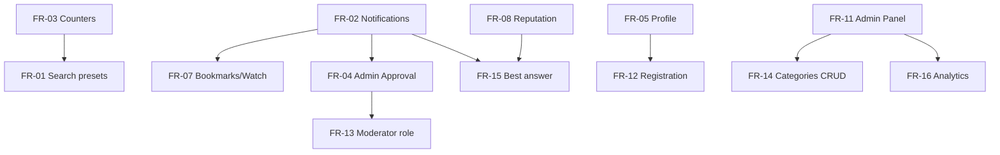
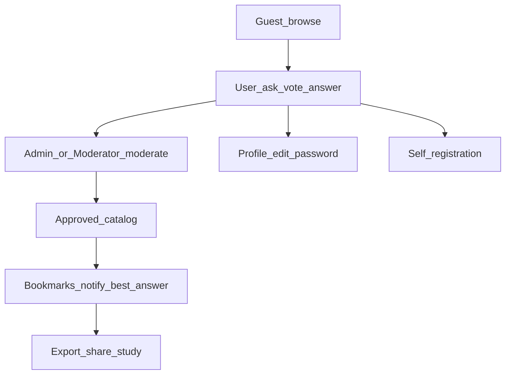

# Техническое задание: развитие QuestionApp

| Поле | Значение |
|------|----------|
| Документ | Техническое задание (функциональные требования) |
| Продукт | QuestionApp — модерируемый каталог учебных вопросов |
| Версия | 1.0 |
| Дата | 2026-08-01 |
| Основание | Roadmap feature ideas (быстрые победы → продуктовый рост) |
| Стек (as-is) | Blazor Server (.NET 10), MongoDB, cookie-auth, `I*Data` / `Mongo*` |

---

## 1. Цель и границы

### 1.1. Цель

Усилить удобство и ценность каталога учебных вопросов без превращения продукта в полноценный Stack Overflow / мессенджер. Закрыть главные боли:

- карточки на ленте неинформативны (заглушки, слабые статусы);
- автор не видит, что произошло с вопросом / ответом;
- Admin тратит слишком много кликов на модерацию;
- нельзя нормально вести аккаунт (профиль, пароль, регистрация).

### 1.2. В scope

Все фичи из разделов «Быстрые победы», «Средний приоритет» и «Крупные фичи» (п. 5–7 настоящего ТЗ).

### 1.3. Вне scope (сознательно)

- Полноценный чат / мессенджер
- Native mobile-приложение
- AI-автоответы как ядро продукта (допустима опция «подсказка» в будущем)
- Микросервисная декомпозиция / смена MongoDB
- Docker / CI / автотесты — не блокируют приёмку фич, но желательны отдельно

### 1.4. Архитектурные ограничения (сохранить)

| Ограничение | Требование |
|-------------|------------|
| Проекты | `QuestionAppUI` (Blazor Server) + `QuestionAppLibrary` (модели + data access) |
| Хранилище | MongoDB, БД `QuestionApp` |
| Auth | Cookie + `UserModel` + `PasswordHasher` (расширять, не ломать текущий login) |
| Совместимость BSON | Сохранять `[BsonElement]` для legacy-полей (`IsAproved`, `AutoredQuestions`) |
| Кэш | `IMemoryCache` для вопросов/справочников; инвалидация при мутациях |
| UI-уведомления | Существующий `ToasterService` — расширять, не заменять |

---

## 2. Текущее состояние (As-Is)

### 2.1. Основной поток

```
Guest browse → User ask/vote/answer → Admin moderate → Approved catalog
```

| Маршрут | Назначение | Ограничение as-is |
|---------|------------|-------------------|
| `/` | Лента одобренных вопросов, фильтры, голосование | Счётчик ответов — заглушка `100`; нет бейджей pending/archive на карточках ленты |
| `/Create`, `/Edit/{Id}` | Создание / редактирование вопроса | — |
| `/Details/{Id}` | Детали, ответы, голоса, смена статуса (Admin) | Approve ответа только здесь |
| `/AdminApproval` | Очередь вопросов на модерацию | Нет массовых действий, нет предпросмотра без ухода, нет очереди ответов |
| `/AdminPanel` | Создание одобренных вопросов/ответов Admin | Нет inline-статуса всех вопросов, нет CRUD категорий |
| `/Profile` | Вопросы пользователя по статусам | Нет редактирования DisplayName/email/пароля |
| Login | Cookie auth | Только seed/demo users; нет регистрации и reset password |

### 2.2. Ключевые сущности

| Коллекция | Модель | Релевантные поля |
|-----------|--------|------------------|
| `questions` | `QuestionModel` | `Question`, `Description`, `Categories`, `Status`, `Author`, `UserVotes`, `IsApproved`, `IsRejected`, `IsArchived` |
| `answers` | `AnswerModel` | `Answer`, `Author`, `QuestionId`, `Votes`, `IsApproved`, `CreateDate` |
| `users` | `UserModel` | `UserName`, `PasswordHash`, `Role`, `DisplayName`, `Email`, authored/voted lists |
| `categories` / `statuses` | справочники | seed-only |

### 2.3. Роли as-is

| Роль | Права |
|------|-------|
| Guest | Просмотр ленты и деталей одобренных вопросов |
| User | Создание вопросов, ответы, голоса, профиль (read-only поля) |
| Admin | Модерация, статусы, seed (`/SampleData`), AdminPanel |

---

## 3. Глоссарий

| Термин | Определение |
|--------|-------------|
| Pending | Вопрос/ответ с `IsApproved = false` и не отклонён |
| Approved catalog | Вопросы с `IsApproved = true`, `IsRejected = false`, `IsArchived = false` (видимы на `/`) |
| Best answer | Ответ, отмеченный автором вопроса как лучший |
| Пресет фильтра | Именованный набор параметров поиска/фильтра, сохранённый для пользователя |
| Подписка (watch) | Пользователь получает уведомления об изменениях вопроса |
| Moderator | Роль с правами модерации контента без админ-операций (seed, удаление пользователей) |

---

## 4. Акторы и права (To-Be)

| Актор | Описание |
|-------|----------|
| Guest | Неавторизованный посетитель |
| User | Зарегистрированный пользователь |
| Moderator | Модератор очереди (новая роль, см. FR-13) |
| Admin | Полный администратор |
| Author | Специализация User — автор конкретного вопроса/ответа |

Матрица прав (целевая):

| Действие | Guest | User | Moderator | Admin |
|----------|:-----:|:----:|:---------:|:-----:|
| Просмотр каталога / деталей approved | ✓ | ✓ | ✓ | ✓ |
| Создать вопрос / ответ | | ✓ | ✓ | ✓ |
| Голосовать | | ✓ | ✓ | ✓ |
| Approve/reject вопросы и ответы | | | ✓ | ✓ |
| Смена статуса вопроса | | | ✓ | ✓ |
| Archive / AdminPanel / seed / CRUD категорий | | | | ✓ |
| Управление пользователями / роли | | | | ✓ |
| Отметить best answer | | Author | | ✓ (опционально override) |

---

## 5. Функциональные требования — быстрые победы

Приоритет внедрения: P0 (1–3 дня на фичу или пакет).

---

### FR-01. Поиск и фильтры с пресетами

**Бизнес-цель:** сценарии «найти своё / недоделанное» работают без ручной сборки фильтров каждый раз.

#### 5.1.1. Функциональность

1. Единое поле поиска на `/` поддерживает запросы по:
   - тексту вопроса / описания;
   - автору (`DisplayName` / `UserName`);
   - тегам/категориям (имя категории);
   - статусу (имя статуса).
2. Существующие фильтры Index сохраняются и сочетаются с поиском (AND логика).
3. Авторизованный пользователь может сохранить текущий набор фильтров как **пресет** с именем.
4. Системные пресеты (доступны без сохранения):
   - «Мои pending» — вопросы текущего пользователя, ожидающие модерации;
   - «Без ответов» — approved-вопросы с нулём одобренных ответов;
   - «Мои вопросы» — все вопросы автора.
5. Пресеты пользователя: создать / переименовать / удалить / применить одним кликом.
6. При применении пресета URL или query-string отражает активные параметры (deep-link / refresh-safe).

#### 5.1.2. Данные

Новое поле в `UserModel` (или отдельная коллекция `filter_presets`):

```text
FilterPresets[]: { Id, Name, Query, CategoryIds[], StatusId?, OnlyMine?, WithoutAnswers?, CreatedAt }
```

#### 5.1.3. UI / маршруты

- Расширить `/` (Index): search box, chips пресетов, управление пресетами.
- Опционально: те же пресеты на `/Profile` для «мои pending».

#### 5.1.4. Критерии приёмки

| ID | Критерий |
|----|----------|
| AC-01.1 | Поиск по DisplayName автора возвращает его вопросы в каталоге |
| AC-01.2 | Пресет «Без ответов» показывает только вопросы с 0 approved-ответов |
| AC-01.3 | Пользовательский пресет переживает logout/login |
| AC-01.4 | Применение пресета восстанавливает все сохранённые параметры |
| AC-01.5 | Guest видит системные пресеты, применимые без auth; «Мои…» скрыты или требуют login |

#### 5.1.5. Затронутые модули

`Index.razor`, `IQuestionData` / `MongoQuestionData`, `IUserData` / `MongoUserData` (или новый `IFilterPresetData`), модели User.

---

### FR-02. Уведомления в приложении

**Бизнес-цель:** автор и подписчики видят события без опроса Admin / Details вручную.

#### 5.2.1. События (минимум)

| Событие | Получатели |
|---------|------------|
| Вопрос одобрен | Author |
| Вопрос отклонён | Author |
| Новый ответ на вопрос | Author (+ watchers из FR-07) |
| Ответ одобрен / отклонён | Author ответа |
| Admin/Moderator сменил статус вопроса | Author (+ watchers) |
| Best answer отмечен (FR-15) | Author ответа |

#### 5.2.2. Функциональность

1. При событии создаётся запись уведомления в хранилище.
2. Toast (`ToasterService`) показывается получателю, если он online в текущей Blazor-сессии (best-effort).
3. Лента уведомлений:
   - маршрут `/Notifications` **или** секция на `/Profile`;
   - список: текст, дата, признак прочитано, ссылка на сущность.
4. Действия: отметить одно / все как прочитанные; счётчик непрочитанных в `LoginDisplay` / header.
5. Уведомления персональные; Guest не имеет ленты.

#### 5.2.3. Данные

Новая коллекция `notifications`:

```text
NotificationModel:
  Id, UserId, Type, Title, Message,
  RelatedQuestionId?, RelatedAnswerId?,
  IsRead, CreatedAt
```

Новые сервисы: `INotificationData` / `MongoNotificationData`, опционально `INotificationService` (создание + toast).

#### 5.2.4. Критерии приёмки

| ID | Критерий |
|----|----------|
| AC-02.1 | После approve вопроса у автора появляется непрочитанное уведомление |
| AC-02.2 | После нового ответа автор вопроса получает уведомление со ссылкой на `/Details/{Id}` |
| AC-02.3 | Счётчик непрочитанных уменьшается после «прочитать все» |
| AC-02.4 | Toast появляется при событии, если пользователь online (не блокирует запись в БД при offline) |

#### 5.2.5. Затронутые модули

`AdminApproval`, `Details`, `AdminPanel`, data layer approve/status; `ToasterService`; `LoginDisplay`; новый page/component Notifications; `RegisterServices`.

---

### FR-03. Счётчики и бейджи на карточках Index

**Бизнес-цель:** карточка отражает реальное состояние вопроса.

#### 5.3.1. Функциональность

1. Заменить заглушку `100` на Index реальным числом **одобренных** ответов по вопросу.
2. Бейджи на карточке (где применимо в контексте отображаемой выборки):
   - «Ожидает модерации» — pending;
   - «Архив» — `IsArchived`;
   - «Отклонён» — `IsRejected` (если такие карточки показываются, напр. Profile).
3. На публичной ленте `/` по-прежнему только approved+not archived; бейджи статусов жизненного цикла вопроса (`Status.Name`) сохраняются/улучшаются.
4. Производительность: не N+1 запросов на карточку — предпочтительно:
   - агрегация counts при загрузке списка; или
   - денормализованное поле `ApprovedAnswerCount` на `QuestionModel` с обновлением при approve/create/reject ответа.

#### 5.3.2. Критерии приёмки

| ID | Критерий |
|----|----------|
| AC-03.1 | Число на карточке = количеству `AnswerModel` с `IsApproved = true` для `QuestionId` |
| AC-03.2 | После одобрения нового ответа счётчик на Index обновляется (после инвалидации кэша / TTL) |
| AC-03.3 | Pending-вопрос (если виден пользователю, напр. Profile) имеет бейдж ожидания модерации |
| AC-03.4 | Архивный вопрос помечен бейджем «Архив» |

#### 5.3.3. Затронутые модули

`Index.razor`, при необходимости `Profile.razor`, `QuestionModel`, `MongoAnswerData` / `MongoQuestionData`.

---

### FR-04. Удобный Admin Approval

**Бизнес-цель:** сократить число кликов и переходов при модерации.

#### 5.4.1. Функциональность

1. **Массовые действия** на `/AdminApproval`:
   - multi-select вопросов;
   - «Approve selected» / «Reject selected»;
   - подтверждение перед массовым reject.
2. **Предпросмотр** деталей вопроса (описание, категории, автор) в side panel / modal **без** навигации на `/Details`.
3. **Очередь ответов на модерацию** на той же странице (вкладки или секции):
   - список pending-ответов с превью текста, автором, ссылкой на вопрос;
   - approve / reject одного и массово;
   - сейчас approve ответа доступен только на Details — перенести/дублировать сюда.
4. После действия — toast + обновление списка + уведомления (FR-02).

#### 5.4.2. Данные / API

Расширить `IAnswerData`:

```text
GetAnswersForApprove()
ApproveAnswer(id) / RejectAnswer(id)  // или UpdateAnswer с флагами
```

Опционально batch-методы в data layer (цикл допустим в UI/service для P0).

#### 5.4.3. Критерии приёмки

| ID | Критерий |
|----|----------|
| AC-04.1 | Admin может одобрить ≥2 вопроса одним действием |
| AC-04.2 | Предпросмотр показывает описание без ухода со страницы |
| AC-04.3 | Pending-ответы видны в очереди AdminApproval |
| AC-04.4 | Approve ответа из очереди делает его видимым на Details для всех |
| AC-04.5 | User/Guest не имеют доступа к `/AdminApproval` |

#### 5.4.4. Затронутые модули

`AdminApproval.razor`, `IAnswerData` / `MongoAnswerData`, `Details.razor` (сохранить одиночный approve), уведомления.

---

### FR-05. Редактирование профиля и смена пароля

**Бизнес-цель:** рабочий аккаунт вместо «мёртвой» ссылки и read-only профиля.

#### 5.5.1. Функциональность

1. На `/Profile` (или `/Profile/Edit`) пользователь редактирует:
   - `DisplayName` (обязательно, 2–50 символов);
   - `Email` (формат email, уникальность — желательно);
   - опционально `Name`, `LastName`.
2. Смена пароля для Mongo-пользователя:
   - текущий пароль + новый + подтверждение;
   - проверка через `IPasswordHasher<UserModel>`;
   - новый hash сохраняется в `PasswordHash`.
3. `UserName` и `Role` пользователь не меняет (Role — только Admin, отдельно).
4. Валидация и сообщения об ошибках на форме; успех — toast.

#### 5.5.2. Критерии приёмки

| ID | Критерий |
|----|----------|
| AC-05.1 | Изменённый DisplayName отображается на карточках/Details после обновления |
| AC-05.2 | Неверный текущий пароль — смена отклоняется, hash не меняется |
| AC-05.3 | После смены пароля login со старым паролем невозможен, с новым — возможен |
| AC-05.4 | Неавторизованный доступ к редактированию — redirect на login |

#### 5.5.3. Затронутые модули

`Profile.razor`, `IUserData.UpdateUser`, Login (без изменений контракта), `PasswordHasher`.

---

## 6. Функциональные требования — средний приоритет

Приоритет: P1 (ориентир — неделя на пакет).

---

### FR-06. Комментарии к ответам (уточнения)

**Бизнес-цель:** короткие уточнения («поясни на примере») без форума.

#### 6.1.1. Функциональность

1. Под каждым approved-ответом на Details — thread комментариев (плоский список, без вложенности >1 уровня).
2. Авторизованный пользователь может добавить комментарий (лимит длины, напр. 1000 символов, plain text или безопасный HTML).
3. Автор комментария или Admin/Moderator может удалить свой/любой комментарий.
4. Комментарии не требуют отдельной модерации в P1 (опционально флаг позже).

#### 6.1.2. Данные

Вариант A (предпочтительный): коллекция `answer_comments`:

```text
AnswerCommentModel: Id, AnswerId, QuestionId, Author, Text, CreatedAt, IsDeleted
```

Вариант B: вложенный массив в `AnswerModel` — допустим при малых объёмах.

#### 6.1.3. Критерии приёмки

| ID | Критерий |
|----|----------|
| AC-06.1 | Комментарий виден под нужным ответом после reload |
| AC-06.2 | Guest не может писать комментарии |
| AC-06.3 | Удаление скрывает комментарий из UI |

---

### FR-07. Закладки и подписка на вопрос

**Бизнес-цель:** сохранить вопрос и получать обновления.

#### 6.2.1. Функциональность

1. **Закладка:** User сохраняет вопрос в личный список; toggle на Details / Index.
2. Страница или секция «Закладки» (Profile или `/Bookmarks`).
3. **Следить (watch):** подписка на события статуса/новых ответов → уведомления FR-02.
4. Закладка и watch могут быть независимы (или watch включается вместе с закладкой — зафиксировать в реализации; по умолчанию: независимо).

#### 6.2.2. Данные

В `UserModel` или отдельные коллекции:

```text
BookmarkedQuestionIds[]
WatchedQuestionIds[]
```

#### 6.2.3. Критерии приёмки

| ID | Критерий |
|----|----------|
| AC-07.1 | Закладка сохраняется между сессиями |
| AC-07.2 | При watch + новый ответ пользователь получает уведомление |
| AC-07.3 | Снятие watch прекращает новые уведомления (уже созданные не удаляются) |

---

### FR-08. Рейтинг и лёгкая геймификация

**Бизнес-цель:** мотивировать наполнение каталога.

#### 6.3.1. Функциональность

1. Правила начисления очков (начальные):
   - +N за одобренный вопрос;
   - +M за одобренный ответ;
   - +K за голос, полученный ответом/вопросом (с анти-абузом: 1 раз от уникального voter).
2. Поле `Reputation` (или `Score`) в `UserModel`.
3. Страница `/Leaderboard` (или `/TopAuthors`): топ авторов по очкам, DisplayName, счётчики вопросов/ответов.
4. Опционально: отображение очков в Profile.

#### 6.3.2. Критерии приёмки

| ID | Критерий |
|----|----------|
| AC-08.1 | После approve вопроса репутация автора увеличивается на N |
| AC-08.2 | Leaderboard сортирует по убыванию очков |
| AC-08.3 | Повторный пересчёт одного и того же события не дублирует очки (идемпотентность) |

---

### FR-09. Медиа и вложения

**Бизнес-цель:** контролируемое использование upload в редакторе.

#### 6.4.1. As-is

`POST /upload/image` (Authorize) → `wwwroot/uploads/`.

#### 6.4.2. To-be

1. Галерея / превью изображений на Details (из HTML описания или явного списка вложений).
2. Лимиты: размер файла, MIME (jpeg/png/webp/gif), max файлов на вопрос.
3. Политика orphan-файлов: фоновая/admin-очистка файлов, не ссылаемых ни одним вопросом/ответом.
4. Удаление вложения автором/Admin при редактировании.

#### 6.4.3. Критерии приёмки

| ID | Критерий |
|----|----------|
| AC-09.1 | Файл сверх лимита отклоняется с понятной ошибкой |
| AC-09.2 | Изображение из вопроса отображается на Details |
| AC-09.3 | Orphan cleanup не удаляет файлы, на которые есть ссылки в контенте |

---

### FR-10. Экспорт и шаринг

**Бизнес-цель:** использование материалов для учёбы вне приложения.

#### 6.5.1. Функциональность

1. **Публичная ссылка** на вопрос: стабильный URL `/Details/{Id}` (уже есть) + кнопка «Копировать ссылку».
2. **Экспорт** вопроса + approved-ответов:
   - Markdown (download `.md`);
   - PDF (P1/P2 — допустимо второй очередью после Markdown).
3. Экспорт доступен для approved неархивных вопросов; для Author/Admin — также своих pending (опционально).

#### 6.5.2. Критерии приёмки

| ID | Критерий |
|----|----------|
| AC-10.1 | «Копировать ссылку» копирует абсолютный URL Details |
| AC-10.2 | Markdown содержит заголовок, описание (text), ответы, авторов |
| AC-10.3 | Неapproved чужой вопрос недоступен для публичного экспорта |

---

### FR-11. Улучшенный Admin Panel

**Бизнес-цель:** операционное управление каталогом из одного места.

#### 6.6.1. Функциональность

1. Таблица/список **всех** вопросов: поиск, фильтр по статусу approve/reject/archive.
2. Inline смена статуса вопроса и быстрый archive/unarchive.
3. Черновики админ-контента: вопрос с флагом `IsDraft` (не в публичном каталоге, не в очереди User-pending) — создание/публикация из AdminPanel.
4. Сохранить текущий сценарий «сразу создать одобренный вопрос/ответ».

#### 6.6.2. Критерии приёмки

| ID | Критерий |
|----|----------|
| AC-11.1 | Admin находит вопрос по тексту за < действия поиска на странице |
| AC-11.2 | Archive скрывает вопрос с `/`; unarchive возвращает при прочих флагах approved |
| AC-11.3 | Draft не виден Guest на Index |

---

## 7. Функциональные требования — крупные фичи

Приоритет: P2 (продуктовый рост).

---

### FR-12. Регистрация и восстановление пароля

**Бизнес-цель:** отказ от модели «только seed/demo users».

#### 7.1.1. Функциональность

1. Самостоятельная регистрация:
   - UserName (unique), Email (unique), DisplayName, Password + confirm;
   - создание `UserModel` с `Role = User`, `ObjectIdentifier` (GUID), hash пароля;
   - авто-login после регистрации или redirect на login.
2. Восстановление пароля:
   - **Вариант A (предпочтительный для учебного стенда):** Admin создаёт/сбрасывает пароль в UI;
   - **Вариант B:** email reset token (требует SMTP-конфиг) — страница «Forgot password» → письмо → установка нового пароля.
3. Страницы: `/identity/account/register`, `/identity/account/forgot-password` (если B).
4. Существующие demo users продолжают работать.

#### 7.1.2. Критерии приёмки

| ID | Критерий |
|----|----------|
| AC-12.1 | Новый пользователь регистрируется и логинится |
| AC-12.2 | Дубликат UserName/Email отвергается |
| AC-12.3 | Reset (выбранный вариант) позволяет задать новый пароль и войти |

---

### FR-13. Модерация по ролям (Moderator)

**Бизнес-цель:** делегировать модерацию без полного Admin.

#### 7.2.1. Функциональность

1. Роль `Moderator` в `UserModel.Role` и claims.
2. Права Moderator:
   - `/AdminApproval`: approve/reject вопросы и ответы;
   - смена статуса на Details;
   - **нет** доступа к `/SampleData`, удалению пользователей, CRUD ролей, (опционально) AdminPanel seed-операциям.
3. Admin назначает/снимает роль Moderator.
4. Обновить `[Authorize(Roles = ...)]` и `LoginDisplay` (ссылки модерации).

#### 7.2.2. Критерии приёмки

| ID | Критерий |
|----|----------|
| AC-13.1 | Moderator одобряет вопрос в очереди |
| AC-13.2 | Moderator получает 403/NotAuthorized на `/SampleData` |
| AC-13.3 | User не получает прав Moderator через UI самообслуживания |

---

### FR-14. Категории как полноценный раздел

**Бизнес-цель:** категории — навигируемый раздел, а не только seed-справочник.

#### 7.3.1. Функциональность

1. Страница категории `/Category/{Id}`: описание, топ-вопросы (по голосам / дате).
2. Admin CRUD категорий и статусов в UI (имя, описание, порядок/активность).
3. Неактивная категория скрыта из Create/фильтров, старые вопросы сохраняют snapshot категории.

#### 7.3.2. Данные

Расширить `CategoryModel`: `Description`, `IsActive`, `SortOrder` (при отсутствии).

#### 7.3.3. Критерии приёмки

| ID | Критерий |
|----|----------|
| AC-14.1 | Страница категории показывает только approved вопросы этой категории |
| AC-14.2 | Admin создаёт категорию без перезапуска/seed |
| AC-14.3 | Инвалидация кэша `CategoryData` после CRUD |

---

### FR-15. «Вопрос решён» / лучший ответ

**Бизнес-цель:** автор фиксирует полезный ответ; он визуально поднимается.

#### 7.4.1. Функциональность

1. Author вопроса отмечает один approved-ответ как best (`AcceptedAnswerId` на вопросе или `IsBestAnswer` на ответе — выбрать один источник истины).
2. Best answer отображается первым и с визуальной меткой.
3. Смена best answer разрешена автору; снятие — разрешено.
4. Событие → уведомление автору ответа (FR-02); опционально очки (FR-08).

#### 7.4.2. Критерии приёмки

| ID | Критерий |
|----|----------|
| AC-15.1 | Только Author (и Admin) может отметить best |
| AC-15.2 | На Details best answer выше остальных |
| AC-15.3 | Одновременно не более одного best на вопрос |

---

### FR-16. Аналитика для Admin

**Бизнес-цель:** видеть здоровье учебного процесса модерации.

#### 7.5.1. Функциональность

Дашборд `/Admin/Analytics` (Admin only):

| Метрика | Описание |
|---------|----------|
| Pending questions / answers | Текущие очереди |
| Avg time to approve | Среднее время от `DateCreated` до approve |
| Activity by day | Создания вопросов/ответов, approve за N дней |
| Top categories | Распределение по категориям |

Минимум P2: серверные агрегации Mongo + простые графики/таблицы в Blazor (без отдельного BI).

#### 7.5.2. Критерии приёмки

| ID | Критерий |
|----|----------|
| AC-16.1 | Число pending совпадает с очередью AdminApproval |
| AC-16.2 | User/Moderator без прав Admin не открывают дашборд (Moderator — по решению продукта; default: только Admin) |
| AC-16.3 | Диапазон дат фильтрует activity series |

---

## 8. Рекомендуемый порядок внедрения

Согласован с максимальным эффектом раньше всего:

| Этап | FR | Обоснование |
|------|----|-------------|
| 1 | FR-03 | Убирает «пустые» карточки |
| 2 | FR-02 | Видимость судьбы вопроса/ответа |
| 3 | FR-04 | Сокращение кликов Admin + очередь ответов |
| 4 | FR-05 | Нормальное ведение аккаунта |
| 5 | FR-15 | Замыкание учебного сценария «вопрос решён» |
| 6 | FR-12 | Рост аудитории без ручного seed |
| 7 | FR-01, FR-07 | Навигация и retention |
| 8 | FR-06, FR-08, FR-09, FR-10 | Вовлечение и учебные сценарии |
| 9 | FR-11, FR-13, FR-14, FR-16 | Операционка и масштаб модерации |

Зависимости:



---

## 9. Нефункциональные требования

| ID | Требование |
|----|------------|
| NFR-01 | Сохранить Blazor Server + Mongo; новые фичи — через `I*Data` и DI в `RegisterServices` |
| NFR-02 | HTML пользовательского контента санитизировать (`SafeHtml`) |
| NFR-03 | Upload — только Authorize; лимиты размера/MIME (FR-09) |
| NFR-04 | Инвалидация кэша вопросов при approve/reject/vote/best/archive |
| NFR-05 | UI desktop + mobile: ключевые страницы Index, Details, AdminApproval, Profile usable на узкой ширине |
| NFR-06 | Сообщения об ошибках — понятные пользователю; без утечки stack trace в UI |
| NFR-07 | Обратная совместимость существующих документов Mongo (legacy BSON names) |
| NFR-08 | Массовые операции модерации — атомарность на уровне документа; частичный успех сообщать Admin |

---

## 10. Модель данных — сводные изменения (To-Be)

| Сущность | Изменения |
|----------|-----------|
| `QuestionModel` | `ApprovedAnswerCount?`, `AcceptedAnswerId?`, `IsDraft?` |
| `AnswerModel` | при необходимости `IsRejected`, `IsBestAnswer` (если не только на вопросе) |
| `UserModel` | edit profile fields as-is; `Reputation`; bookmarks/watches; filter presets |
| `NotificationModel` | **новая** коллекция |
| `AnswerCommentModel` | **новая** коллекция (или embed) |
| `CategoryModel` | `Description`, `IsActive`, `SortOrder` |
| `FilterPreset` | embed в User или отдельная коллекция |

Новые интерфейсы data access (ориентир): `INotificationData`, `IAnswerCommentData`, при необходимости `IFilterPresetData`, методы batch/approve в существующих `IAnswerData` / `IQuestionData`.

Новые маршруты (ориентир):

| Маршрут | FR |
|---------|----|
| `/Notifications` | FR-02 |
| `/Bookmarks` | FR-07 |
| `/Leaderboard` | FR-08 |
| `/Category/{Id}` | FR-14 |
| `/Admin/Analytics` | FR-16 |
| `/identity/account/register` (+ forgot-password) | FR-12 |
| расширение `/Profile`, `/AdminApproval`, `/AdminPanel`, `/` | FR-01,03,04,05,11 |

---

## 11. Требования к UX (общие)

1. Toast для короткой обратной связи; лента уведомлений — для истории.
2. Массовые деструктивные действия (reject, delete) — confirm dialog.
3. Пустые состояния: «Нет pending», «Нет закладок», «Нет уведомлений» — с подсказкой следующего шага.
4. Не перегружать Index: счётчик + бейдж + существующие фильтры; пресеты — компактные chips.
5. AdminApproval: вкладки «Вопросы» / «Ответы», чекбоксы, панель предпросмотра.

---

## 12. Тестирование и приёмка

### 12.1. Стратегия

На каждую FR — ручной чеклист по AC-*. Автотесты не обязательны в рамках этого ТЗ, но критичные правила (пароль, роли, счётчики) желательно покрыть unit/integration отдельно.

### 12.2. Тестовые роли

Использовать demo: `Ramil`/`Tom`/`Kate` (User), `Admin` (Admin); после FR-13 — отдельный пользователь `Moderator`.

### 12.3. Definition of Done (на фичу)

- [ ] AC-* выполнены
- [ ] Затронутый кэш инвалидируется
- [ ] Права ролей проверены (Unauthorized / NotAuthorized)
- [ ] Уведомления создаются там, где FR зависит от FR-02
- [ ] Документация `ARCHITECTURE.md` обновлена (маршруты, коллекции) — по факту реализации
- [ ] Нет регрессии: login demo users, создание вопроса, approve, ответ, голос

---

## 13. Риски и открытые вопросы

| # | Тема | Рекомендация аналитика |
|---|------|------------------------|
| 1 | Счётчик ответов: realtime aggregate vs денормализация | Для P0 — денормализация `ApprovedAnswerCount` проще для Index |
| 2 | Password reset: SMTP vs Admin reset | Для стенда без почты — Admin reset (FR-12A); SMTP — FR-12B |
| 3 | Best answer: поле на Question vs Answer | Источник истины — `Question.AcceptedAnswerId` |
| 4 | Moderator vs Analytics | Analytics только Admin, пока не запрошено иное |
| 5 | Комментарии и модерация | P1 без очереди; при спаме — добавить IsApproved позже |
| 6 | Обновление DisplayName в embedded `BasicUserModel` | При смене профиля — обновить snapshot в authored questions/answers или читать DisplayName по UserId |

---

## 14. Приложения

### 14.1. Целевой пользовательский поток (после внедрения топ-фич)



### 14.2. Трассировка Roadmap → FR

| # в roadmap | Название | FR |
|-------------|----------|-----|
| 1 | Поиск и фильтры / пресеты | FR-01 |
| 2 | Уведомления в приложении | FR-02 |
| 3 | Счётчики и бейджи | FR-03 |
| 4 | Удобный Admin Approval | FR-04 |
| 5 | Редактирование профиля | FR-05 |
| 6 | Комментарии к ответам | FR-06 |
| 7 | Закладки и «следить» | FR-07 |
| 8 | Рейтинг / геймификация | FR-08 |
| 9 | Медиа и вложения | FR-09 |
| 10 | Экспорт / шаринг | FR-10 |
| 11 | Улучшенный Admin Panel | FR-11 |
| 12 | Регистрация и reset password | FR-12 |
| 13 | Роль Moderator | FR-13 |
| 14 | Категории как раздел | FR-14 |
| 15 | «Вопрос решён» / best answer | FR-15 |
| 16 | Аналитика Admin | FR-16 |

### 14.3. Связанные документы

- [`ARCHITECTURE.md`](ARCHITECTURE.md) — текущая архитектура, маршруты, коллекции
- [`TECHNOLOGY_MAP.md`](TECHNOLOGY_MAP.md) — стек и зависимости
- [`README.md`](../README.md) — запуск и demo users

---

*Конец технического задания.*
