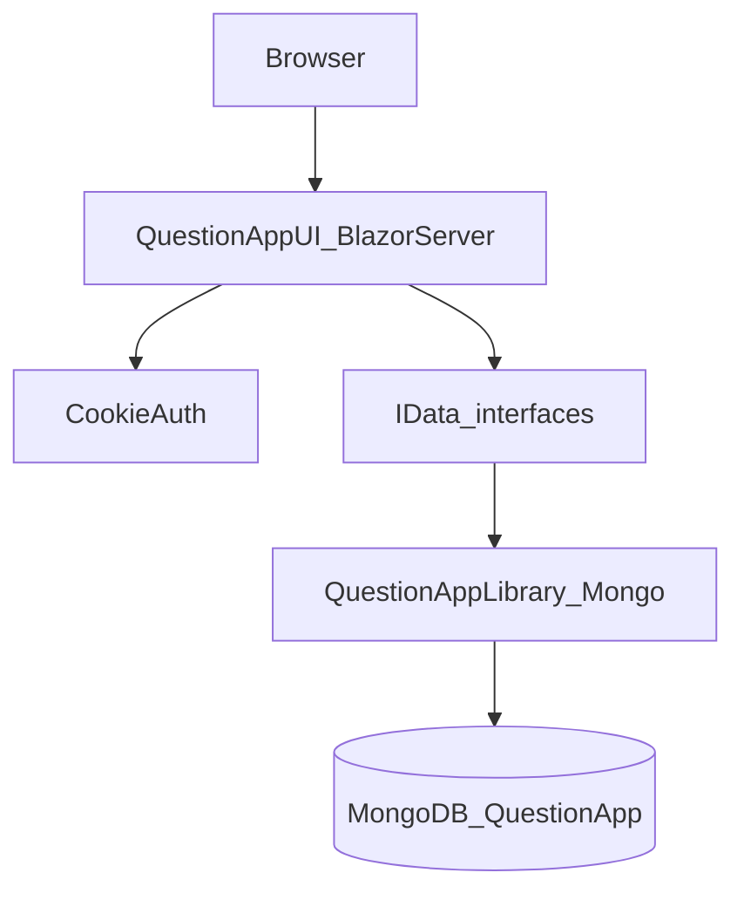
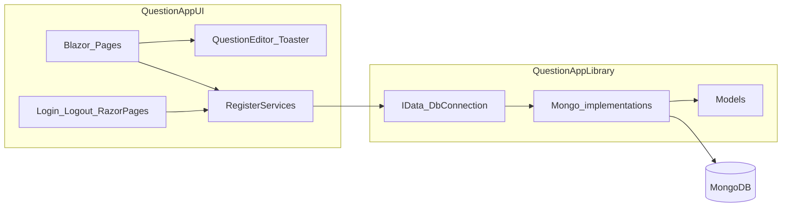

# Технологическая карта

Актуально для текущего состояния репозитория (Target Framework `net10.0`).

## Обзор слоёв

| Слой | Технология | Роль |
|------|------------|------|
| Клиент | Браузер (SignalR / Blazor Server circuit) | UI и интерактивность |
| Host / UI | ASP.NET Core Blazor Server | Страницы, компоненты, cookie-auth |
| Прикладной доступ к данным | Интерфейсы `I*Data` | Абстракция над хранилищем |
| Реализация данных | `Mongo*Data` + `DbConnection` | Работа с коллекциями MongoDB |
| Хранилище | MongoDB | Персистентность |

## Runtime и SDK

| Компонент | Версия / значение | Источник |
|-----------|-------------------|----------|
| .NET SDK | `10.0.301` (`rollForward: latestFeature`) | [`global.json`](../global.json) |
| Target Framework | `net10.0` | оба `.csproj` |
| Решение | Visual Studio / `dotnet` CLI | [`QuestionApp.sln`](../QuestionApp.sln) |

## Стек по проектам

### QuestionAppUI

| Область | Технология | Версия |
|---------|------------|--------|
| Host SDK | `Microsoft.NET.Sdk.Web` | — |
| UI | Blazor Server (`AddServerSideBlazor`, `MapBlazorHub`) | ASP.NET Core 10 |
| Компоненты UI | Radzen.Blazor | **11.2.0** |
| CSS / JS layout | Bootstrap | **5.3.0** (CDN JS; локальный CSS) |
| Иконки | Google Material Icons / Material Symbols Outlined | CDN |
| Auth | Cookie Authentication | ASP.NET Core |
| Кэш (через DI) | `IMemoryCache` | shared framework |

### QuestionAppLibrary

| Область | Технология | Версия |
|---------|------------|--------|
| Library SDK | `Microsoft.NET.Sdk` | — |
| MongoDB driver | MongoDB.Driver | **3.10.0** |
| Кэш | Microsoft.Extensions.Caching.Memory | **10.0.10** |
| Конфигурация | Microsoft.Extensions.Configuration.Abstractions | **10.0.10** |

## NuGet-пакеты

| Пакет | Версия | Проект |
|-------|--------|--------|
| Radzen.Blazor | 11.2.0 | QuestionAppUI |
| MongoDB.Driver | 3.10.0 | QuestionAppLibrary |
| Microsoft.Extensions.Caching.Memory | 10.0.10 | QuestionAppLibrary |
| Microsoft.Extensions.Configuration.Abstractions | 10.0.10 | QuestionAppLibrary |

## Frontend-ассеты

Источник: [`QuestionAppUI/Pages/_Layout.cshtml`](../QuestionAppUI/Pages/_Layout.cshtml).

| Ассет | Путь / URL |
|-------|------------|
| Bootstrap CSS | `css/bootstrap/bootstrap.min.css` |
| Bootstrap JS | `https://cdn.jsdelivr.net/npm/bootstrap@5.3.0/dist/js/bootstrap.bundle.min.js` |
| Radzen CSS | `_content/Radzen.Blazor/css/material-base.css` |
| Radzen JS | `_content/Radzen.Blazor/Radzen.Blazor.js` |
| Blazor Server | `_framework/blazor.server.js` |
| Стили приложения | `css/site.css`, `QuestionAppUI.styles.css` |
| Шрифты | Google Material Icons, Material Symbols Outlined |

Host Blazor: [`_Host.cshtml`](../QuestionAppUI/Pages/_Host.cshtml) — `render-mode="ServerPrerendered"`.

## Конфигурация

| Ключ | Значение | Файл |
|------|----------|------|
| `DatabaseName` | `QuestionApp` | [`appsettings.json`](../QuestionAppUI/appsettings.json) |
| `ConnectionStrings:MongoDB` | `""` (пусто) | `appsettings.json` |
| `ConnectionStrings:MongoDB` | `mongodb://localhost:27017` | [`appsettings.Development.json`](../QuestionAppUI/appsettings.Development.json) |

### Launch URLs

Профиль `QuestionAppUI` в [`launchSettings.json`](../QuestionAppUI/Properties/launchSettings.json):

- `https://localhost:7123`
- `http://localhost:5172`

## Карта зависимостей (логическая)

## Чего в репозитории нет

| Область | Статус |
|---------|--------|
| Docker / docker-compose | отсутствует |
| CI (GitHub Actions и аналоги) | отсутствует |
| Тестовые проекты | отсутствуют |
